# 诡秘之主 · 俱乐部管理 — 功能说明与使用手册

> 内部运营手册 ｜ v1.0 · 2026-11-06 ｜ 基于线上正式版整理
> 配图在 `docs/使用手册-配图/`（红框序号与正文步骤编号一一对应，原图保留于 `项目页面截图/`）
> 管理端登录后，侧栏「使用手册」经接口读取同一份 `docs/使用手册.html`（须登录；配图内嵌，不单独公开）。

---

## 〇 总览：这套系统能干什么

一套给「诡秘之主」MMO 单俱乐部用的运营工具，分两端：

- **PC 管理后台**（浏览器打开）——管理员用：管成员、发活动、审入会、看出勤、发公告、管晒图
- **微信小程序**——全体成员用：看名单、报名活动、组队、晒图、收提醒

| 能力 | 干什么用 | 谁操作 |
|------|----------|--------|
| 成员名册 | 集中维护角色名、非凡评分、风尚度、途径、职位；支持游戏截图 OCR 批量导入 | 管理员维护，全员可查 |
| 邀请码入会 | 把成员微信与名单中的角色安全关联，外人进不来 | 管理员发码、审核 |
| 活动日程 | 一次性 / 每日 / 每周活动；成员表态参加、待定、请假；可配微信提醒 | 管理员发布，成员表态 |
| 组队 LFG | 活动下开队伍招募，队长审批、满员、到点自动开始 | 成员建队 / 队长管理 |
| 出勤看板 | 今日 / 本周 RSVP 汇总、实到点名、成员出勤摘要 | 管理员 |
| 公告 / 资料 / 踏云寻芳 | 公告轮播通知；俱乐部门面；成员晒风景自拍 | 管理员发布，成员晒图 |

### 角色与权限

| 角色 | 能做什么 |
|------|----------|
| 超管 | 管理员全部能力 ＋ 任命/取消管理员 ＋ 应急账号。全俱乐部通常 1～2 人 |
| 管理员 | 成员增删改、截图导入、邀请码审核、活动与公告、提醒配置、出勤点名、踏云寻芳管理。不能任命管理员 |
| 成员 | 看名单与公告、活动报名、组队、晒图、收提醒、看自己的报名记录 |
| 访客 | 刚进小程序还没关联角色：只能填邀请码申请入会，看不到名单和活动 |

---

## 一 登录管理后台

**用来干什么**：管理员进入 PC 后台的唯一入口。正常走微信扫码确认；二维码出不来时，用「票号」或应急账号。

> ⚠️ **重要变化（2026-11-04 起）**：未进行微信认证的主体，微信平台不再下发小程序码，扫码登录会显示「暂时无法显示登录码」。这不是故障——改用下面两种方式登录。

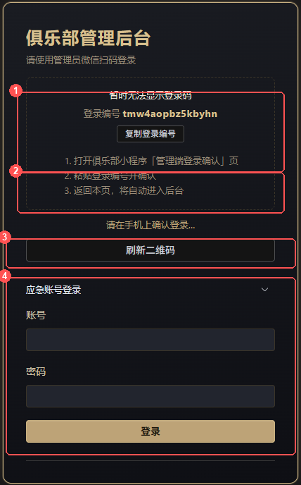

### 方式一：票号登录（推荐）

1. 打开管理后台登录页，页面显示一行「**登录编号**」（如 `tmw4aopbz5kbyhn`），点「**复制登录编号**」。
2. 打开小程序，进入「**我的** → 扫码」（管理员身份才显示该入口），进入「管理端登录确认」页。
3. 把登录编号**粘贴**进去，确认。
4. 回到 PC 页面，稍等一两秒**自动进入后台**。

### 方式二：应急账号登录

1. 在登录页点开「**应急账号登录**」折叠区。
2. 输入账号 `admin`、密码 `admin`（当前设置），点「登录」。

> 🔴 **安全提示**：应急账号等同于超管。不要把密码发给普通成员；如怀疑泄露，由超管在服务器 `.env` 的 `EMERGENCY_*` 修改后重启服务。

---

## 二 成员列表

**用来干什么**：俱乐部名册的总账本——谁在会里、评分多少、什么途径、什么职位，全在这维护。也是截图 OCR 导入、任命管理员的操作台。

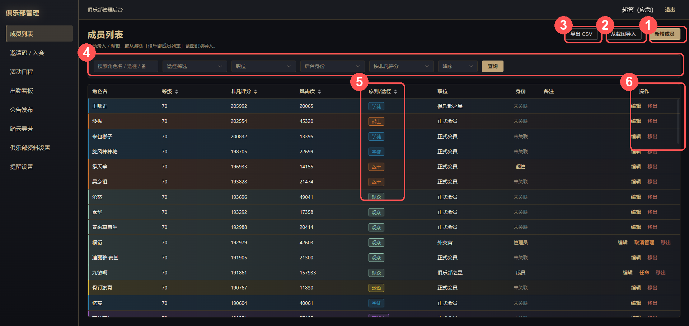

### 2.1 手动新增 / 编辑一名成员

1. 点右上「**新增成员**」（改人则点该行「**编辑**」）。
2. 填**角色名**（必填、全俱乐部唯一）、等级、**非凡评分**、风尚度、序列/途径（下拉六选一，可留空）、职位（会长/副会长/外交官/俱乐部之星/正式会员/骨干/成员/候补）、备注。
3. 点「保存」。备注是**全员可见**的。

### 2.2 从截图导入（OCR，批量录入的主力）

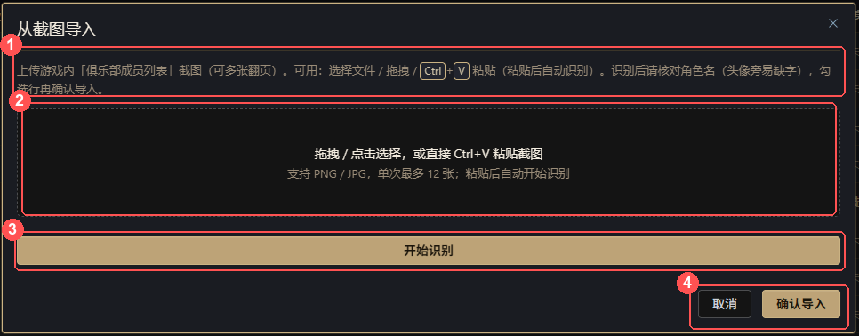

1. 点「**从截图导入**」，把游戏内「俱乐部成员列表」截图**直接 `Ctrl+V` 粘贴**进弹窗（也支持点选、拖拽），单次最多 **12 张**，粘贴后自动识别。
2. 识别完成出现**预览表**：每行一个成员，标「新增」还是「更新」。逐行核对——**角色名最容易被头像挡住缺字**，直接在表格里改。
3. 不要的行**取消勾选**，点「**确认导入**」。按角色名匹配：没有 → 新增；已有 → 更新评分等字段。

> ✅ **移出的人回来了**：不用手工恢复。截图导入或手录同名角色，系统自动把他恢复为在职并更新字段。

> 识别引擎优先 RapidOCR，兜底 Tesseract。识别不准多为截图模糊或游戏 UI 改版——重截清晰图或预览表手改即可。

### 2.3 筛选、排序、导出

- 筛选：关键字（角色名/途径/备注）、途径**多选**、职位、后台身份（超管/管理员/已关联/未关联）
- 排序：默认非凡评分降序，可切风尚度、等级、途径、角色名、入会时间
- 「**导出 CSV**」：全量导出名单，Excel 打开备份

### 2.4 移出成员

1. 点该行「**移出**」→ 确认。成员标记「已退出」，**同时解除微信关联**（小程序自动降为访客）。
2. 反悔：按 2.1 重录同名，或 OCR 导入同名，即恢复在职。

### 2.5 任命 / 取消管理员（仅超管）

1. 目标成员必须已绑定微信（身份列不是「未关联」）。
2. 点该行「**任命**」→ 确认，此后他能扫码/票号登录后台。
3. 「**取消管理**」降回成员：后台进不来，小程序成员能力保留。

### 2.6 小程序端：成员 Tab

底部 Tab「成员」即名册：排序（评分/风尚/入会）、途径与职位筛选齐全，点卡片看详情。角色名按**途径色**着色。

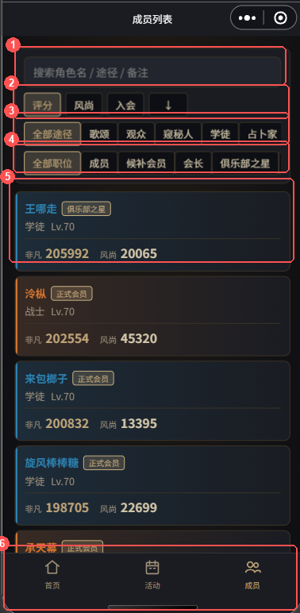

---

## 三 邀请码 / 入会

**用来干什么**：把「名单上的角色」和「成员的微信」绑在一起。邀请码**不会新建角色**——名单外的角色名直接被拒。

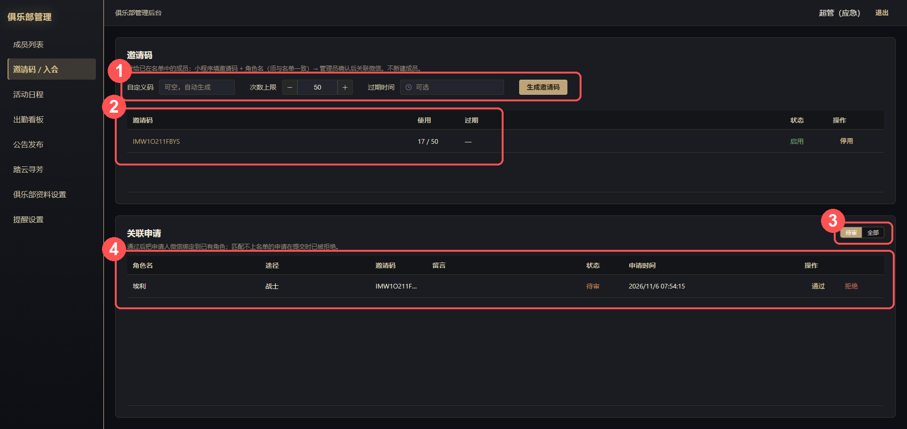

### 3.1 管理端：发码与审核

1. 生成表单：可选**自定义码**（留空自动生成）、**次数上限**、**过期时间**，点「生成邀请码」。
2. 把码发给真实成员。点列表里的码文字即**复制**；用完/过期可「停用」。
3. 成员提交后，「关联申请」表出现记录。核对角色名是本人 →「**通过**」；可疑 →「拒绝」。
4. 通过后该微信立即能看名单、报活动。

### 3.2 小程序端：成员自助关联

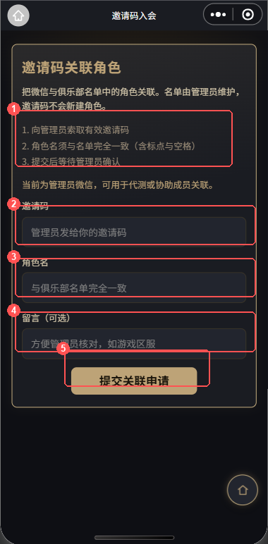

1. 进小程序，首页点「**邀请码关联角色**」。
2. 输入**邀请码**＋与名单**完全一致的角色名**（标点、空格也要一致），可留言（如游戏区服）。
3. 提交后显示「关联申请审核中」，等管理员通过。角色名不在名单或已被绑定，会直接拒绝提交。

---

## 四 活动日程

**用来干什么**：发布管理俱乐部活动——日常、周本、PVP；支持一次性与每周循环。成员在小程序报名（RSVP），到点前可收微信提醒。

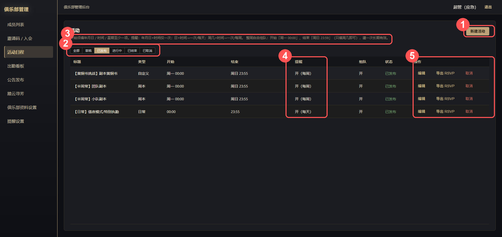

### 4.1 新建一场活动

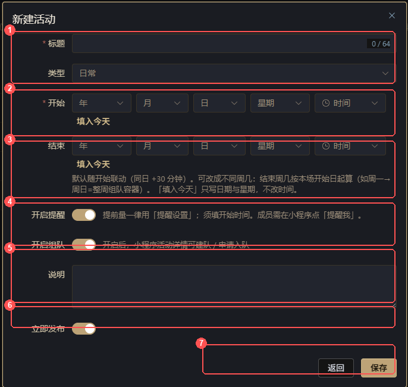

1. 点「**新建活动**」，填标题、选类型（日常/周本/PVP/自定义）。
2. 填**开始**时间——「分量」式填写，**填什么决定周期**（见下表）；可点「填入今天」。
3. **结束**留空默认开始后 30 分钟；「整周自由组队」容器 = 开始「周一 00:00」＋结束「周日 23:59」（只填周几）。
4. 打开「**开启提醒**」（提前量统一用「提醒设置」）和「**开启组队**」（默认开）。
5. 勾「**立即发布**」直接上架（不勾存草稿），点「保存」。

| 开始分量 | 活动周期 | 举例 |
|----------|----------|------|
| 年月日＋时间 | 一次性，一场 | 11月20日 20:00 周六团 |
| 周几＋时间 | 每周循环 | 周三 20:30 每周三团 |
| 日＋时间（无月） | 每天循环 | 每日 21:00 值夜 |
| 仅周几（无时间） | 每周整天容器 | 配合结束「周日」做整周容器 |

> ⚠️ **整周组队容器**：不进「今日活动」、不进首页会务条——它只是一周的容器。真正开打时间写在**队伍**上；哪支队伍开打日期是今天，该活动才被抬进今日列表。

### 4.2 活动生命周期

草稿 → 已发布 → 进行中 → 已结束；发布后可取消。

- **一次性活动**：到结束时刻自动「已结束」，并自动关闭下属招募中的队伍。
- **周期活动**：保持「已发布」。每场结束自动清空本场 RSVP 与队伍、滚下一场；详情页显示「下一场」时间。

### 4.3 导出 RSVP

活动行点「**导出 RSVP**」→ 周期活动可选「本场」或历史**场次日**（换场前自动留存快照）→ 下载 CSV（角色名、途径、状态、活动时间）。

### 4.4 小程序端：成员怎么报名

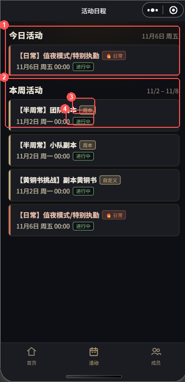

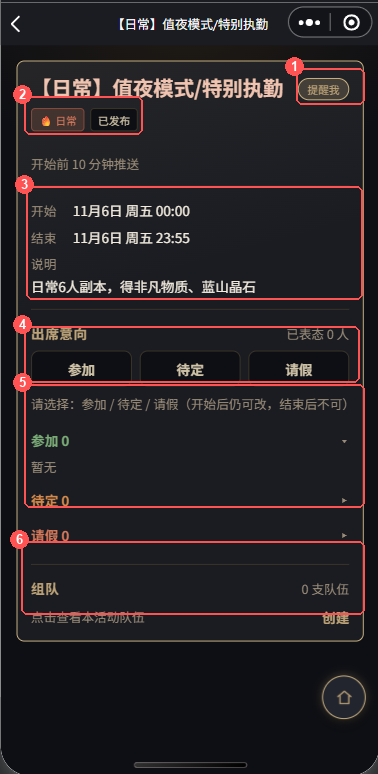

1. Tab「**活动**」分「今日活动」「本周活动」，卡片显示类型、时间、是否进行中。
2. 详情页「出席意向」选**参加 / 待定 / 请假**；**开始后仍可改，本场结束锁定**。各状态名单按途径色展示。
3. 收提醒：点「**提醒我**」完成微信订阅授权，开始前按提前量推送。

> ⚠️ **微信一次性授权**：点一次只够推**本场**一条。每周活动下一场要再点「**续订提醒**」——微信平台限制，不是 Bug。

---

## 五 组队

**用来干什么**：活动下开「车队」招人。管理端不直接操作队伍（队伍总览已暂缓），全流程在小程序。

### 5.1 规则速览

| 规则 | 说明 |
|------|------|
| 挂靠活动 | 队伍必须建在「开启组队」的活动下 |
| 人数 | 上限 ≥2，默认 6 |
| 门槛 | 队长可设「要求评分」，不足者不可申请 |
| 审批 | 申请需**队长审批**；满员自动停招，退出自动重开 |
| 到点 | 到「开打时间」自动变「已开始」 |
| 唯一性 | 同一活动一人一队 |

### 5.2 小程序端：建队与入队

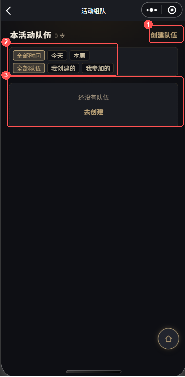

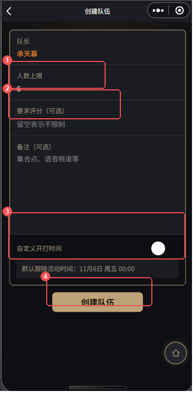

1. **建队**：活动详情 → 组队区 →「创建」。设人数、可选评分门槛、备注（集合点/语音频道）；开打时间默认跟活动、可自定义。
2. **入队**：队伍列表挑队 → 详情 → 附言「提交申请」→ 等队长通过。
3. **队长日常**：「待审批」通过/拒绝；队员可「转让」「踢出」；可「关闭招募」「撤销队伍」。有人申请时「我的」页与首页会务条出红点。
4. **筛选**：今天/本周；我创建的/我参加的。

---

## 六 出勤看板

**用来干什么**：回答三个问题——今天有什么活动、谁来没来、最近谁活跃谁消失。RSVP 是意向，这里是「实到」的账本。

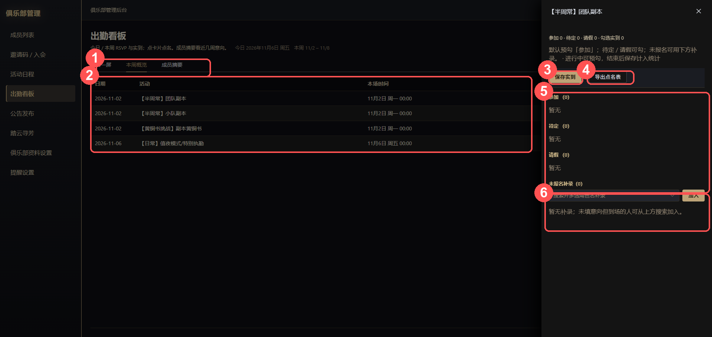

1. **今日一屏**：今天每场活动一张卡片（RSVP 三态、招募中队伍、缺几人），点卡片开**点名抽屉**。
2. **本周概览**：本周各场次参加/待定/请假/实到一张表，点行进抽屉。
3. **点名**：按参加/待定/请假分组，**默认预勾「参加」**，核实后「保存实到」。进行中可预勾，结束后保存才计入。没报名但到了的，用「未报名补录」搜索加上。
4. **导出点名表**：按抽屉当前勾选导出 CSV（角色名、途径、RSVP、实到、场次日）。
5. **成员摘要**：近 2/4/8 周，看每人参加、待定、请假、实到、意向场次、**意向率**；点行看近场明细。

> 统计口径：意向率 = 有 RSVP 的已结束场次中「参加」占比；实到与 RSVP 相互独立。

---

## 七 公告发布

**用来干什么**：发俱乐部通知；置顶的转着圈顶在最前面。

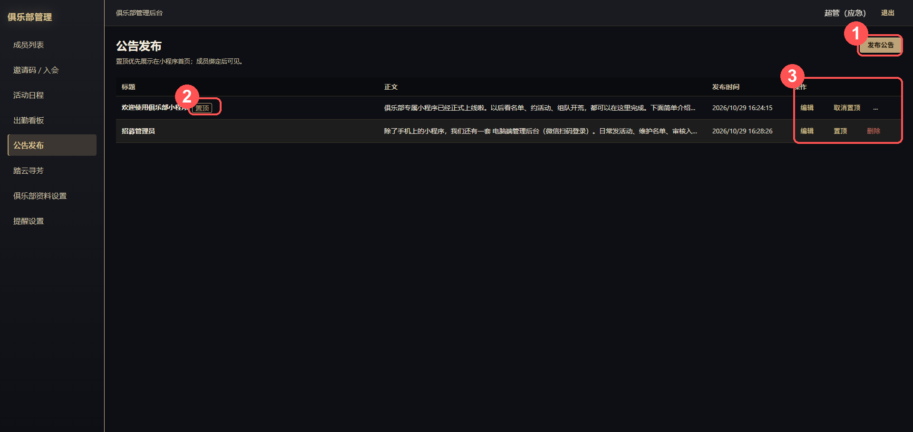

1. 「**发布公告**」：标题＋正文（≤4000 字）＋置顶开关。
2. 列表可「编辑」「**置顶/取消置顶**」「删除」。
3. **小程序端**：公告在**首页轮播**（自动播、置顶优先）；「查看更多」进全部列表；点某条轮播自动展开该条。

---

## 八 踏云寻芳

**用来干什么**：成员晒图墙——游戏风景、角色自拍＋题目，互相点赞。管理端管总量与违规内容。

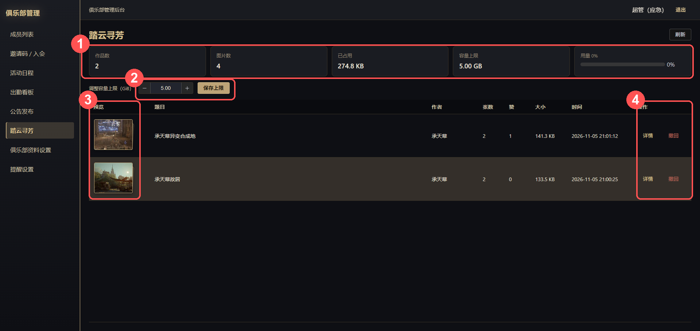

### 8.1 管理端

1. 顶部统计卡：作品数、图片数、已占用、容量上限、用量百分比。
2. 云存储默认软配额 **2 GiB**；快满了在「调整容量上限」改数字 →「保存上限」。
3. 点缩略图/「详情」看全部图片；「**撤回**」整部下架（详情里可删单张）。

### 8.2 小程序端

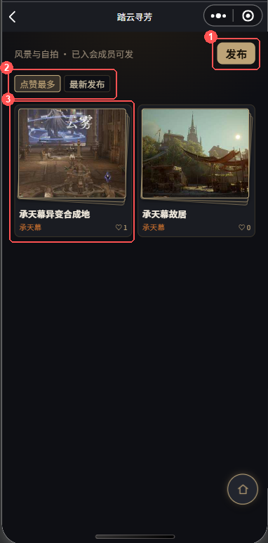

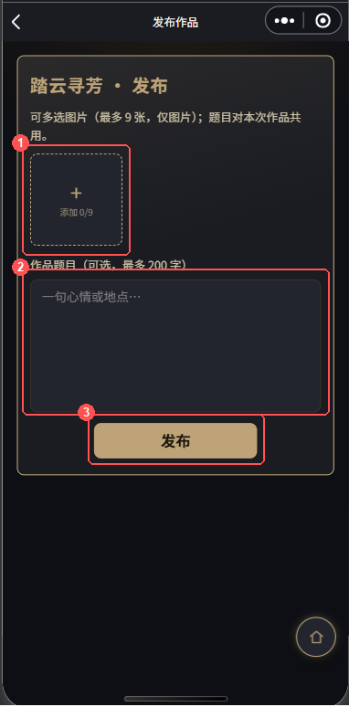

1. **发布**：列表右上「发布」→ 选图（最多 9 张，自动压缩）→ 填题目 → 发布；作品后续可续传。
2. **互动**：详情页点赞；只能删/撤回**自己**的作品。仅已入会成员可发可看。
3. **详情页**：翻看同作品各图、点赞、（作者）续传或删图。
4. 首页「踏云寻芳」区块自动轮播最新作品。

---

## 九 俱乐部资料设置

**用来干什么**：小程序首页「门厅」门面——名称、图标、一句话简介。

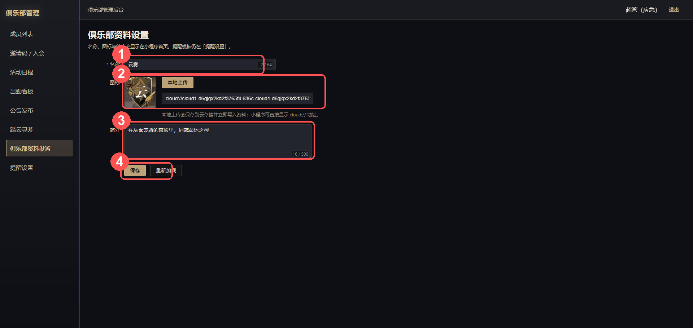

1. 改**名称**（首页金色大字）。
2. 改**图标**：「本地上传」选方图（自动传云存储）；或粘贴图片链接。
3. 改**简介**，「保存」后小程序首页立即生效。

---

## 十 提醒设置

**用来干什么**：全俱乐部微信提醒的总开关——提前多久、用什么模板、发哪个版本。

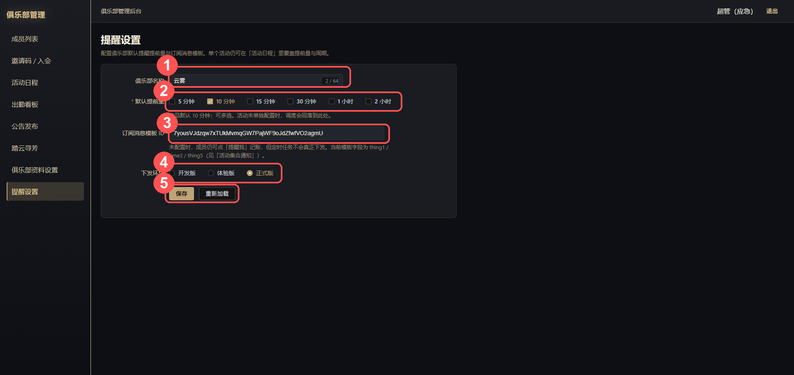

| 配置项 | 怎么填 |
|--------|--------|
| 默认提前量 | 可多选：5/10/15/30 分钟、1/2 小时；默认 10 分钟。**单个活动不单独设，一律用这里** |
| 订阅消息模板 ID | 微信公众平台 → 订阅消息 →「活动集合通知」模板 ID（字段 thing1/time3/thing5）。**不填则「提醒我」只记账、不下发** |
| 下发环境 | 选「正式版」（正式上线后的正确值） |

> 提醒链路：活动开「开启提醒」→ 成员点「提醒我」授权 → 云函数按提前量下发。任何一环缺失都不响。

---

## 十一 小程序首页与「我的」

**用来干什么**：首页是每天打开的「会务大厅」；「我的」是个人事务中心。

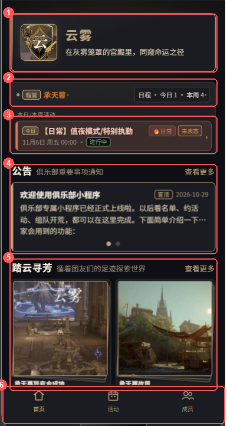

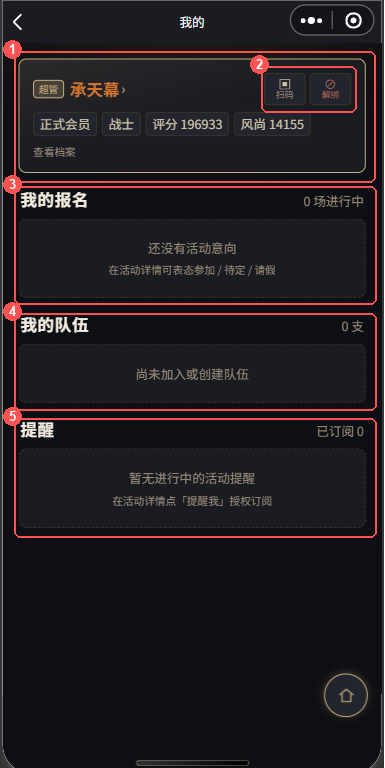

- **会务条**：左身份（点进「我的」，有队长待审批时出红点）；右「日程 · 今日 n · 本周 n」进活动 Tab。
- **本日/本周活动**：最多 5 条，今日优先；跨日周常容器不出现（除非今天有队伍开打）。
- **访客视图**：未关联者只见「加入俱乐部」三步引导。
- **「我的」页**：身份卡（管理员多「扫码」＝票号登录确认入口、「解绑」）；待我处理（队长审人）；我的报名（进行中＋近 14 天已结束）；我的队伍；提醒订阅。所有页面支持下拉刷新。

---

## 十二 常见问题 FAQ

| 问题 | 答案 |
|------|------|
| 登录页二维码出不来？ | 2026-11-04 起未认证主体微信不再下发小程序码。改**票号登录**或应急账号 `admin`/`admin` |
| OCR 角色名缺字？ | 头像遮挡，正常。预览表里改后导入；或重截清晰图 |
| 成员看不到名单/活动？ | 微信未关联角色，走邀请码流程 |
| 没收到活动提醒？ | 查：活动开了提醒吗 → 成员点过「提醒我」吗 → 模板 ID 配了吗。周期活动每场要重新授权 |
| 手滑移出了人？ | 手录或 OCR 导入同名即自动恢复在职 |
| 周期活动报名「没了」？ | 每场结束自动清 RSVP＋队伍滚下一场，设计行为；需要留档换场前「导出 RSVP」 |
| 整周容器不在今日活动？ | 跨日容器只进「本周活动」；队伍开打日期是今天才抬入今日 |
| 踏云图片误删能找回吗？ | 不能，撤回/删除是尽力删除，无回收站 |
| 邀请码能发多少人？ | 生成时设「次数上限」，用完自动失效，可手动停用；一个角色名只绑一个微信 |
| 游戏 UI 改版 OCR 失效？ | 解析按当前游戏版面写的，官方改版需调逻辑——先手录顶着 |

---

## 附录 A 状态机速查

- **入会申请**：待审核 → 通过（绑定微信）/ 拒绝
- **活动**：草稿 → 已发布 → 进行中 → 已结束；已发布后可取消。一次性到点自动结束并关闭招募中队伍；周期活动保持已发布、按场滚动
- **队伍**：招募中 ⇄ 已满员 ⇄ 已关招募；到点 → 已开始；队长可撤销（不再显示）
- **入队申请**：待审批 → 通过/拒绝；成员可撤回；队长可踢出

## 附录 B 途径色对照

| 途径 | 色值 | 途径 | 色值 |
|------|------|------|------|
| 观众 | `#94c7b1` | 学徒 | `#2c81b0` |
| 战士 | `#d3742e` | 占卜 | `#54599f` |
| 歌颂 | `#debd39` | 窥秘 | `#975dc1` |

名单、报名、队伍、晒图里的角色名颜色按此着色；未填途径用默认色。

## 附录 C 名词表

| 名词 | 含义 |
|------|------|
| 非凡评分 / 风尚度 | 游戏内官方战力与时装评分 |
| RSVP | 出席意向：参加/待定/请假三态 |
| 实到 | 管理员点名的真实到场，与 RSVP 分开记账 |
| 本场 / 场次日 | 周期活动的一次具体发生 |
| 整周组队容器 | 周一 00:00～周日 23:59 的周常活动，供全周建队 |
| 票号（登录编号） | 登录页一次性短码，小程序「我的 → 扫码」粘贴确认登录 |
| 会务条 | 小程序首页顶部的身份＋日程摘要条 |
| 踏云寻芳 | 成员晒图功能名 |

---

*使用手册 v1.0 ｜ 文档随版本更新，如与实际界面不符以线上版本为准*
