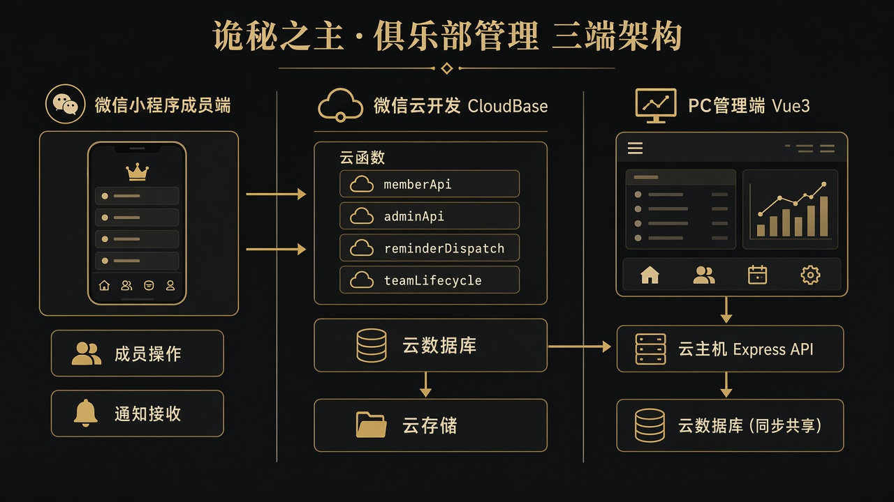
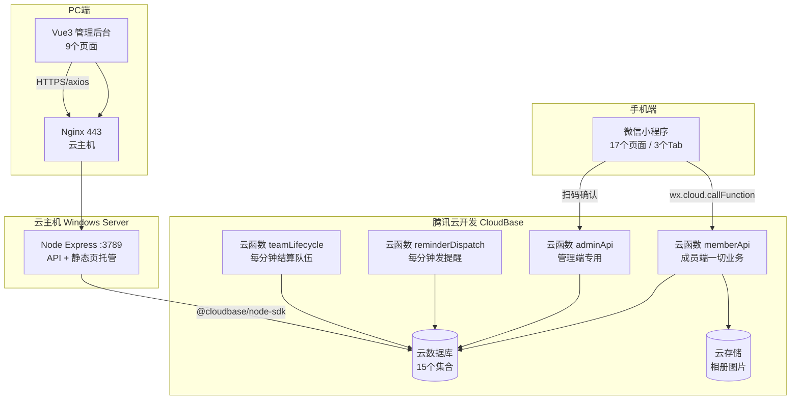
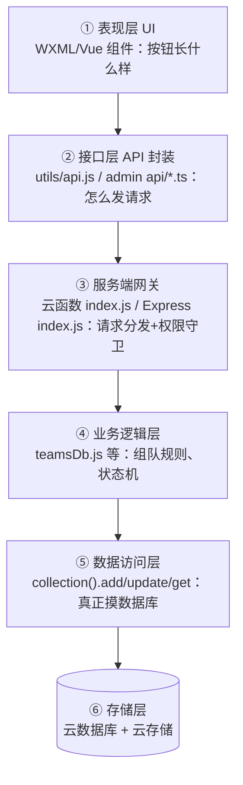
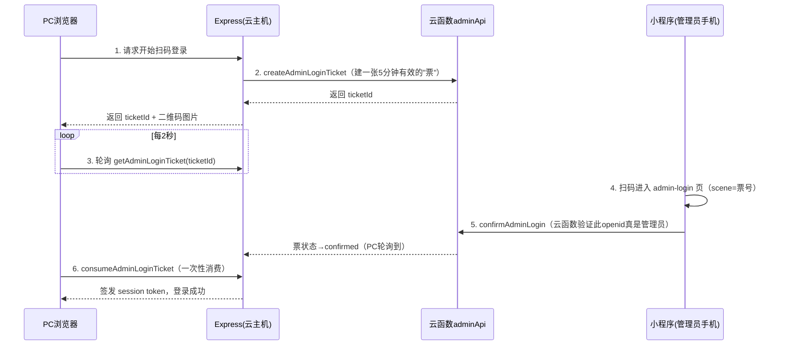
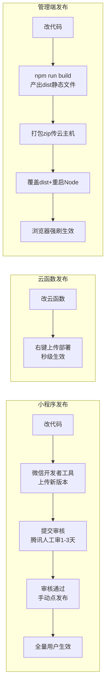

# 俱乐部管理 · 技术全景科普（昕哥学习版 · 源码精讲）

> **这份文档和《技术科普学习手册》什么关系？**  
> 那份是"地图"，带你认路；这份是"解剖课"，带你开膛——所有技术点都**基于真实源码**讲解，代码是从项目里一段段摘出来的，带你看到 Agent 替你做的每一个技术决策长什么样。
>
> **怎么读**：结论先行，图解辅助，代码带注释。每章末尾有"一句话记住"。  
> **前置背景**：不需要会编程。你学过 Python 异步和 JS，文中会顺手用它们做类比，看不懂类比也不影响主线。
>
> 数据说话：本项目 **4 端代码约 2.2 万行、111 个源码文件**（小程序 4174 行 / 管理端 5883 行 / 云函数 5848 行 / 本地与云主机服务 6075 行），全部由 Agent 在与你的多轮对话中独立完成。

---

## 目录

1. [项目总体需求概述](#1-项目总体需求概述)
2. [顶层设计思路](#2-顶层设计思路)
3. [功能划分与分层](#3-功能划分与分层)
4. [各部分技术选型及理由](#4-各部分技术选型及理由)
5. [名词扫盲：从云函数到轮询](#5-名词扫盲从云函数到轮询)
6. [分功能关键技术点（源码精讲）](#6-分功能关键技术点源码精讲)
7. [运维 · 部署 · 发布](#7-运维--部署--发布)
8. [工程巧思与踩坑 Top 10](#8-工程巧思与踩坑-top-10)
9. [一页速查表](#9-一页速查表)

---

## 1. 项目总体需求概述

### 1.1 一句话

给「诡秘之主」MMO 的**单个俱乐部**（约 100~200 人）做一套运营工具：

> **成员战力可查、活动不易忘、组队可招、晒图有氛围、出勤可盘。**

| 谁在用    | 用什么             | 干什么                        |
| ------ | --------------- | -------------------------- |
| 普通成员   | **微信小程序**（手机）   | 看名单、看活动、报名（RSVP）、组队、晒图、设提醒 |
| 管理员/超管 | **PC 网页后台**（电脑） | 录成员、发公告、排活动、审批入会、看出勤、管相册   |
| 系统     | **云端**          | 定时发提醒、定时结算队伍、存所有数据         |

### 1.2 需求从哪来：两条产品原点

整个项目最初只解决两个痛点，其余都是后来"叠"上去的：

```
痛点1：成员战力不清（非凡评分、风尚度、途径散落在游戏截图里）
   ↓ 产品手段
   管理端手录 + 【截图 OCR 批量识别导入】（本项目技术含量最高的一块）

痛点2：活动容易忘（周本、日常、PVP 时间一多就漏）
   ↓ 产品手段
   活动日程 + RSVP 报名 + 【微信订阅消息提醒】（另一块技术硬骨头）
```

之后按 P0→P4 分期逐步叠加：邀请码入会 → 扫码登录 → 组队 LFG → 踏云寻芳（晒图）→ 出勤看板 → 本周会务。

### 1.3 明确"不做"的边界（同样重要）

Agent 开发前和你约定了负面清单：**不做**陪玩分账、积分商城、语音、游戏官方 API 自动同步、多俱乐部 SaaS、DKP。

> 科普点：商业软件项目里，"明确不做什么"和"做什么"同样重要——没有边界的项目会无限膨胀，这叫 **scope creep（范围蔓延）**。提前写进文档（`AGENTS.md` 铁律第 5 条）是工程成熟度的体现。

---

## 2. 顶层设计思路

### 2.1 全景架构图





**看懂这张图，这个项目就懂了一半**。核心结构叫"三端两路"：

- **三端**：小程序、管理后台、后端服务，物理上完全分开；
- **两路（双通道后端）**：同一份云数据库，小程序从"云函数通道"访问，PC 后台从"Express 通道"访问。

### 2.2 为什么要"三端分离"？

| 端     | 为什么必须是独立的                                                  |
| ----- | ---------------------------------------------------------- |
| 小程序   | 只能跑在微信的运行时里，用 WXML/WXSS 写页面（微信自创的类 HTML/CSS），和浏览器技术**不通用** |
| PC 后台 | 管理员要大表格、拖拽上传截图、导出 Excel——手机屏幕干不了这活                         |
| 后端    | 权限校验、密钥、定时任务绝不能放在用户手机/浏览器里（前端代码任何人都能拆开看）                   |

> 类比：就像一家店，前厅（小程序）、办公室（管理后台）、仓库+保险柜（后端）必须分开——顾客能逛前厅，但碰不到保险柜。

### 2.3 为什么要"双通道后端"？（本项目最关键的设计）

**问题**：微信云函数有个天然限制——**只有微信小程序能直接调用它**。普通浏览器打开一个网页，是没有"微信登录态"的，云函数拿不到你的身份。

**解法**：两条通道连**同一个数据库**，而不是复制两份数据：

| 通道         | 谁在用   | 怎么连数据库                                | 怎么证明"我是谁"              |
| ---------- | ----- | ------------------------------------- | ---------------------- |
| 云函数通道      | 小程序   | `wx-server-sdk`（微信内置）                 | 微信自动注入 **openid**，伪造不了 |
| Express 通道 | PC 后台 | `@cloudbase/node-sdk` + 密钥（存在服务器环境变量） | 应急密码登录 或 手机扫码确认        |

```mermaid
flowchart LR
    subgraph 通道A
        MP[小程序] -->|callFunction| CF[云函数]
    end
    subgraph 通道B
        PC[浏览器] -->|axios| EX[Express]
    end
    CF --> DB[(同一个云数据库)]
    EX --> DB
    style DB fill:#3d3524,stroke:#bda377
```



> 类比（用你熟悉的 JS/Python）：数据库是一个共享对象，两条通道是两个不同的"客户端 SDK"——就像同一个 MongoDB，浏览器端用 mongoose、Node 端用 official driver，指向同一个库。数据永远只有一份，不会出现"小程序里改了、后台看不到"的同步噩梦。

### 2.4 安全设计的三条底线

1. **身份信任根**：小程序端的用户身份以 `cloud.getWXContext().OPENID` 为准——这是微信平台在**服务端**注入的，前端传什么都不信。源码注释原话："客户端伪造不了"。
2. **写操作必走服务端**：前端（手机/网页）只负责"发起请求"，所有"改数据"的动作都在云函数/Express 里校验角色后才执行。
3. **密钥不进仓库**：`CLOUDBASE_SECRET_KEY`、`WECHAT_APP_SECRET`、应急密码全部放在 `.env` 文件里，`.env` 永远不提交到 GitHub（AGENTS.md 铁律）。

---

## 3. 功能划分与分层

### 3.1 纵向切：按产品功能（你口中的"功能"）

| 模块     | 小程序侧         | 管理端侧                        | 云端侧                               |
| ------ | ------------ | --------------------------- | --------------------------------- |
| 成员档案   | 名册查看、成员详情    | 手录 CRUD、OCR 导入、CSV 导出、任命管理员 | members 集合 + adminApi/membersDb   |
| 入会绑定   | 邀请码+角色名申请页   | 审批入会、生成邀请码                  | invites/join_applications 集合      |
| 活动日程   | 今日/本周列表、RSVP | 排期、周期活动、意向导出                | activities 集合 + scheduleMatch 纯函数 |
| 订阅提醒   | 「提醒我」授权按钮    | 提醒提前量配置                     | reminderDispatch 定时发送             |
| 组队 LFG | 建队/申请/审批/踢人  | （总览暂缓）                      | teams 集合 + teamLifecycle 到点结算     |
| 踏云寻芳   | 拍图压缩上传、点赞、轮播 | 作品管理、按作品聚合                  | 云存储 + gallery_posts 集合            |
| 出勤看板   | —            | 今日一屏、点名抽屉、实到、成员意向率          | activity_attendance 集合            |
| 公告/资料  | 轮播、列表        | 发布管理、俱乐部资料                  | announcements / club_profile      |
| 本周会务   | 首页会务条+缺口     | —                           | weekHubDb 聚合计算                    |

### 3.2 横向切：按软件分层（工程师的切法）

任何一次"成员点击报名"，代码都像洋葱一样一层层穿过去：



> 科普点：这叫 **分层架构（Layered Architecture）**，每层只跟相邻层说话。好处是"换一层的实现不影响别层"——本项目真实发生过：dev-server 的数据层通过策略模式在"本地 JSON 文件"和"云数据库"之间一键切换（`DATA_BACKEND=cloud` 环境变量），上层 60 多个路由一行没改。

### 3.3 仓库目录 ↔ 职责速查

```
俱乐部管理/
├── miniprogram/        小程序（成员端，纯原生，零 npm 依赖）
│   ├── app.js          13行：只做一件事——wx.cloud.init 初始化云开发
│   ├── app.json        全局配置：17个页面、3个Tab、暗色导航栏
│   ├── pages/          17个页面目录，每个页面4件套(.js/.wxml/.wxss/.json)
│   ├── utils/          api.js(请求封装)、galleryUpload.js(压缩上传)、datetime.js(时区兜底)
│   └── styles/         tokens.wxss(色板变量)、pathway.wxss(途径色)
├── admin/              管理后台（Vue3 + Element Plus + Vite）
│   └── src/
│       ├── views/      9个页面（MembersView 1016行最大）
│       ├── api/        http.ts(axios拦截器) + 9个业务模块
│       ├── router/     路由表 + 登录守卫
│       └── styles/     tokens.css（换肤只改这一个文件）
├── cloud/
│   ├── functions/      4个云函数（跑在腾讯云开发里）
│   │   ├── memberApi/       4000行：成员端全部业务的"总管家"，12个子模块
│   │   ├── adminApi/        694行：管理端专用（成员CRUD+扫码登录票）
│   │   ├── reminderDispatch/ 369行：每分钟检查并发提醒
│   │   └── teamLifecycle/    56行：定时壳，转发给memberApi
│   └── dev-server/     本地/云主机 Express 服务（6075行）
│       └── src/        index.js(1036行全部路由) + ocr/(三级OCR引擎) + cloud*.js(12个数据模块)
└── docs/               24份文档（本项目"文档驱动开发"的产物）
```

---

## 4. 各部分技术选型及理由

### 4.1 选型总表

| 部位      | 选了什么                                 | 理由（Agent 的决策逻辑）                                                |
| ------- | ------------------------------------ | -------------------------------------------------------------- |
| 小程序框架   | **微信原生**（非 uni-app/Taro）             | 单端需求，无跨端诉求；原生最稳、调试最直接，不引第三方抽象层                                 |
| 小程序后端   | **微信云开发 CloudBase**                  | 免运维（无需买服务器/证书）、openid 天然打通、和提审发布一体                             |
| 管理端框架   | **Vue 3 + Element Plus**             | 组件库自带表格/弹窗/抽屉，管理后台 80% 是表格，用现成组件省一半代码                          |
| 管理端构建   | **Vite**                             | 开发热更新快，`npm run build` 产出纯静态文件，扔哪儿都能跑                          |
| 状态管理    | **不用 Pinia/Vuex**，localStorage + ref | 管理端真正的全局状态只有"登录 token"一个，引状态库是杀鸡用牛刀                            |
| PC 后端   | **Express（Node.js）**                 | 生态最成熟的极简 Web 框架；`SERVE_ADMIN=1` 时还能顺手托管静态页，一台 Node 进程包办 API+网页 |
| 云主机连接云库 | **@cloudbase/node-sdk**              | 腾讯官方 SDK，用密钥（SecretId/Key）直连云数据库，这是"PC 没有微信登录态"问题的官方答案         |
| OCR     | **三级引擎**（详见 §6.1）                    | 中文识别精度、成本、环境依赖三方平衡                                             |
| 图片处理    | **sharp**                            | Node 生态最快的图像处理库，灰度/反色/放大一行一个                                   |
| 提醒推送    | **微信订阅消息**（非短信）                      | 免费、点开直达小程序活动页；短信要钱且跳转体验断裂                                      |

### 4.2 三个"为什么不"（选型思维比选型结果更值钱）

**① 为什么小程序不用 uni-app/Taro？**  
这类框架的价值是"一套代码编译到微信/支付宝/抖音多端"。本项目**只需要微信端**，引入抽象层反而多一层"框架 bug 的可能性"，且原生文档最全。→ *单端项目，原生优先。*

**② 为什么管理端不塞进小程序里？**  
管理员要在 1080p 屏幕上看 20 列的成员表、拖拽上传 12 张截图、勾选出勤——这些交互在小程序里要么做不了要么做得很痛苦。且小程序每个页面包体积有限制。→ *交互复杂度决定载体。*

**③ 为什么提醒用订阅消息不用短信？**  
订阅消息：免费、点击直达活动详情页；短信：按条收费、用户还要自己再打开小程序。→ *同样触达，体验和成本双优。（代价：订阅消息是"一次授权一次发送"，所以有"续订"设计，见 §6.3。)*

---

## 5. 名词扫盲：从云函数到轮询

按"遇见顺序"排列，每个都给出**本项目中的真实对应物**。

### 5.1 微信生态组

| 名词              | 大白话解释                                                         | 本项目对应                                                  |
| --------------- | ------------------------------------------------------------- | ------------------------------------------------------ |
| **小程序 AppID**   | 小程序的"身份证号"                                                    | `wx0a3fc7a2aee9f66f`，微信后台分配，代码里靠它认主人                   |
| **openid**      | 微信给每个用户在**每个小程序**里发的唯一编号。同一个用户在你的小程序里永远同一个 openid，但换个 app 就变了 | 鉴权的根基。用户点任何按钮，云函数自动知道"这是 openid=xxx 在操作"，用户无感知、前端也无法伪造 |
| **WXML / WXSS** | 微信自创的"类 HTML/类 CSS"，语法相似但跑在微信自己的渲染器里                          | 小程序所有页面结构/样式                                           |
| **TabBar**      | 小程序底部的导航栏                                                     | 首页 / 活动 / 成员 三个 Tab，选中色是品牌橄榄褐 `#bda377`                |
| **备案**          | 小程序面向公众提供服务前，须向工信部登记主体信息                                      | 2026-10-28 通过——没备案不能正式上线                               |

### 5.2 云开发（CloudBase）组 ⭐ 全项目地基

| 名词                       | 大白话解释                                                                                  | 本项目对应                                                                               |
| ------------------------ | -------------------------------------------------------------------------------------- | ----------------------------------------------------------------------------------- |
| **云开发 CloudBase**        | 腾讯云的"Serverless 套餐"：数据库+文件存储+代码运行环境打包给你，**不用管服务器**                                     | 环境 ID `cloud1-d6gjqx2kd2f3765f4`，小程序 app.js 里第一行就初始化它                               |
| **云函数**                  | 一段跑在腾讯云上的 Node.js 代码。小程序通过"点名调用"触发它，它干完活把结果返回。**没有常驻服务器**——没调用时它不存在，有调用时腾讯临时拉起一个实例跑完销毁 | 本项目 4 个云函数。类比 Python：想象一个"自动伸缩的远程函数"，`callFunction` 相当于 RPC 远程调用                    |
| **云函数冷启动**               | 云函数"从不存在到能干活"需要几秒拉起时间                                                                  | 这是 OCR 不放云函数跑的原因之一（OCR 引擎几百 MB，冷启动+包体积都不可接受）                                        |
| **云数据库**                 | CloudBase 内置的文档型数据库（本质是 MongoDB 阉割版），数据以 JSON 文档存储，不是表格行                               | 15 个集合（集合≈关系库的"表"）：members、activities、teams……                                       |
| **集合（collection）**       | 文档数据库里的"表"，表里每行是一个 JSON 文档                                                             | 如 `members` 集合里一条文档：`{name:"昕哥", pathway:"战士", powerScore:520, boundOpenid:"oXXX"}` |
| **云存储**                  | CloudBase 内置的文件网盘                                                                      | 踏云寻芳的图片。存的是 `cloud://` 协议的 fileID，**浏览器不认识**，要换成临时 HTTPS 链接才能显示（见 §6.6）             |
| **定时触发器（timer trigger）** | 云函数的"闹钟"附件，用 cron 表达式指定何时自动执行                                                          | `0 */1 * * * * *` = 每分钟执行一次，挂在 reminderDispatch 和 teamLifecycle 上                   |
| **订阅消息**                 | 微信官方的"服务通知"推送：用户**主动授权一次**，开发者才能发**一条**                                                | 活动开始前 N 分钟提醒。一次性授权特性决定了"续订"设计                                                       |

### 5.3 Web 前端组

| 名词                  | 大白话解释                                               | 本项目对应                                                     |
| ------------------- | --------------------------------------------------- | --------------------------------------------------------- |
| **Vue 3**           | 主流前端框架之一：把页面拆成一个个"组件"，数据一变页面自动更新                    | 管理后台 9 个页面，全部 Vue 组件                                      |
| **Element Plus**    | 基于 Vue 的现成 UI 组件库（表格/弹窗/表单/抽屉都是拼装件）                 | 管理端大量 `el-table`、`el-drawer`、`el-upload`                  |
| **Vite**            | 前端构建工具：开发时秒级热更新；`build` 时把 Vue/TS 压缩打包成浏览器能直接跑的静态文件 | `npm run dev` 起本地开发（端口 5173），`npm run build` 出 `dist/` 目录 |
| **SPA（单页应用）**       | 整个网站其实只有一个 HTML 文件，页面切换靠 JS 动态渲染，不刷新                | 管理后台；Nginx/Express 配 SPA fallback 让刷新子页面不 404             |
| **axios**           | 浏览器端最流行的 HTTP 请求库                                   | 管理端所有 API 调用的载体，配了拦截器自动带 token、自动处理 401                   |
| **CORS（跨域）**        | 浏览器安全策略：A 网站的 JS 默认不许请求 B 域名的接口，服务端要显式放行            | Express 用 `cors` 包配白名单 `ADMIN_CORS_ORIGIN`                |
| **CSS 变量 / tokens** | 把颜色、间距定义成变量，组件只引用变量不写死值                             | "改整体风格只动主题模块"这条铁律的技术实现，见 §6.7                             |

### 5.4 Node 与 API 组

| 名词                  | 大白话解释                                          | 本项目对应                                                                                     |
| ------------------- | ---------------------------------------------- | ----------------------------------------------------------------------------------------- |
| **Node.js**         | 让 JS 能脱离浏览器、跑在服务器上的运行时                         | 云函数和 Express 都是 Node 写的                                                                   |
| **Express**         | Node 生态最极简的 Web 框架：一行代码注册一个"路径→处理函数"的映射        | dev-server 1036 行注册了 50+ 个路由                                                              |
| **路由（route）**       | "什么 URL + 什么方法 → 交给哪个函数处理"的对应关系                | `PUT /api/activities/:id/attendance` = "更新某活动的实到名单"                                       |
| **REST 风格**         | URL 当名词、HTTP 方法当动词：GET 查、POST 建、PUT 改、DELETE 删 | dev-server 路由全按此设计                                                                        |
| **中间件（middleware）** | 请求到达处理函数前先流经的一道道"安检门"                          | multer（解析上传的图片）、cors（跨域放行）                                                                |
| **环境变量 / .env**     | 存配置和密钥的文本文件，**不进代码仓库**                         | `CLOUDBASE_SECRET_KEY`、应急账号密码等 8 项                                                        |
| **SDK**             | Software Development Kit，官方封装好的"调用工具包"         | `wx-server-sdk`（云函数内用）、`@cloudbase/node-sdk`（服务器用）、`tencentcloud-sdk-nodejs-ocr`（腾讯云 OCR） |
| **轮询（polling）**     | 客户端每隔 N 秒问一次"好了没？"——像排队取餐不断看叫号屏                | 扫码登录：PC 每 2 秒查一次票据状态，见 §6.2                                                               |


### 5.5 工程协作组

| 名词                | 大白话解释                | 本项目对应                                                     |
| ----------------- | -------------------- | --------------------------------------------------------- |
| **Git / GitHub**  | 代码版本管理 + 云端托管        | `github.com/yingxiaxin/club_management`，跨电脑开发靠 `git pull` |
| **commit / push** | 打一个版本快照 / 推到云端       | 每次 Agent 收工都会 commit，进度文件里记录了 `1278565` 等版本号              |
| **Node Modules**  | npm 安装的第三方包存放目录，体积巨大 | 所以 `node_modules` 不进 Git（.gitignore），换电脑 `npm install` 重装 |

---

## 6. 分功能关键技术点（源码精讲）

> 以下每一段代码都是**从本项目源码里真实摘出来的**，带注释精讲。

### 6.1 OCR 截图识别导入 —— 本项目技术含金量之王

**业务**：管理员把游戏里的成员列表截图（最多 12 张）拖进管理后台，系统自动认出每行的"角色名/职位/等级/评分"，人工确认后入库。

**难点**：游戏截图是**深色 UI + 艺术字 + 有头像列干扰**，通用 OCR 直接识别效果差。

#### ① 三级引擎"火箭"（按优先级自动降级）

| 级  | 引擎                              | 文件                  | 为什么                                                                |
| -- | ------------------------------- | ------------------- | ------------------------------------------------------------------ |
| 一选 | **RapidOCR**（Python 本地跑）        | `ocr/rapidOcr.js`   | 中文角色名识别**最准**，还能返回每个字的**坐标**，可以按坐标做"版面解析"（Y 相聚成行、X 排序成列），而不是瞎猜文本顺序 |
| 二选 | **tesseract.js**（npm 包，WASM 实现） | `ocr/recognize.js`  | 兜底：不依赖 Python 环境。语言包 `chi_sim.traineddata` 直接放进仓库，避免每次下载           |
| 三选 | **腾讯云 OCR**（可选付费）               | `ocr/tencentOcr.js` | 精度付费选项，代码里动态 import，没安装就中文提示引导 `npm i`                             |

> 科普点：**WASM（WebAssembly）** 是一种能在 Node/浏览器里以接近原生速度运行的字节码格式。tesseract.js 把 C++ 写的 OCR 引擎编译成 WASM，JS 就能直接调——这就是"npm install 一下就有 OCR 能力"的魔法。
>
> RapidOCR 的调用方式也值得看：Node **spawn 一个 Python 子进程**去跑识别脚本——两种语言跨进程协作（Node 负责调度、Python 负责识别），探测代码会依次尝试 `py -3 / python / python3` 三种命令。

#### ② 图像预处理：先"化妆"再识别

游戏截图深底白字，OCR 引擎喜欢黑字白底。所以识别前用 **sharp** 做了一串流水线：

```
原图 → 灰度 → 反色(黑底白字变白底黑字) → 归一化 → 线性增强 linear(1.65, -35)
     → lanczos 算法放大 2~2.5 倍(小字变大字) → 锐化 → 交给 OCR
```

还有一个基于**宽高比启发式**的裁切：如果图是 16:9 且高度≥700（判断为游戏整屏截图），就按比例裁掉左上角的头像侧栏区，只留表格主体——因为头像图案会严重干扰文字识别。

#### ③ 双通道识别 + 按"评分对"合并

Tesseract 模式下跑两次识别（一次只认职位往右的列、一次整表），结果按 `角色名-评分` 组合键合并去重，名字保留"完整度得分"更高的那个：

```js
// ocr/recognize.js —— 名字质量打分：越长越完整、含汉字加分
const nameScore = (n) =>
  (n.length >= 2 ? 10 : 0) + n.length + (/[\u4e00-\u9fff]/.test(n) ? 3 : 0)
```

#### ④ 绝不自动入库（产品级防呆）

识别结果是"候选行"，管理端弹窗展示可编辑预览表，每行标注：

|   |   |
| - | - |

- `action: create|update` —— 对照云库已有成员，判断是新增还是更新；
- `lowConfidence` —— 低置信标记（角色名<2字会黄字警告"头像旁易缺字"）；
- 全部勾选后**二次确认**才提交，且 jobId 防重复提交（409 冲突）。

#### ⑤ 工程加固细节

- **重试只重试"值得重试的错"**（`ocr/netError.js`）：`ECONNRESET/ETIMEDOUT` 等瞬时网络错误重试 3 次退避递增；4xx 这类"重试也没用"的错立刻抛给用户。
- **内存泄漏防护**：tesseract.js 的 worker 连续识别 30 张后 `terminate` 重建——WASM 实例用久了内存碎片会涨，重建是最简单粗暴的解法。
- **降级路径**：云库核对失败时不让用户白等，返回"全部标待人工确认"的降级预览。

**一句话记住**：OCR = 预处理（反色放大）→ 多引擎识别 → 坐标版面解析 → 人工确认 → 幂等入库。

### 6.2 扫码登录 —— 四层降级的跨端协作

**业务**：管理员在 PC 打开后台要登录，但 PC 网页拿不到微信身份。解法：PC 出一个二维码 → 管理员用微信扫 → 手机小程序里确认"是我" → PC 拿到登录态。



**核心科普点**：

1. **"票"（ticket）模式**：数据库 `login_tickets` 集合里一条 5 分钟过期的文档，状态机 `pending → confirmed → consumed`，外加读时惰性判 `expired`（不用定时器去清扫过期票，读到时顺手判——省一个定时任务）。
2. **防劫持的关键**：确认动作发生在**手机**（openid 由微信注入，无法伪造），PC 只是"等结果"。票只能消费一次。
3. **四层可用性降级**（真实注释："失败不阻断建票"）：
   - ① 云函数 `openapi.wxacode.getUnlimited` 生成小程序码 →
   - ② 挂了？本机用 `WECHAT_APP_SECRET` 直接调微信 HTTPS 接口补码（自带 access_token 2 小时缓存）→
   - ③ 还挂？显示"登录编号"文本，管理员手动去小程序里输票号 →
   - ④ 终极兜底：应急账号密码登录（账密在服务器 .env 里，不进代码）。

> 科普点：**为什么轮询不用"推送"？** 网页端实时推送需要 WebSocket 长连接，对一个"一天登录几次"的管理后台来说太重。2 秒一次轮询简单可靠，票状态查询又是极轻量的读操作——**技术上更炫的方案 ≠ 更合适的方案**。

### 6.3 订阅消息提醒 —— 定时器 + 去重记账的教科书

**业务**：活动开始前 N 分钟（管理员可配），给设了提醒的成员发微信"服务通知"。

**机制链**：成员点「提醒我」→ 微信弹授权框（`wx.requestSubscribeMessage`）→ 授权后调云函数记入 `subscriptions` 集合 → 云函数 `reminderDispatch` 的定时触发器**每分钟**醒来扫一遍 → 到点的发消息 → 记账防重发。

```js
// reminderDispatch/index.js —— 真实发送代码
await cloud.openapi.subscribeMessage.send({
  touser: sub.openid,
  templateId,                                    // 「活动集合通知」模板，ID存云库可配
  page: `pages/activity-detail/index?id=${activity.id}`,  // 点通知直达活动页
  miniprogramState,                              // formal正式/trial体验，测试不误发正式用户
  data: {
    thing1: { value: truncate(activity.title, 20) },   // 活动名
    time3:  { value: formatStartText(activity) },      // 集合时间
    thing5: { value: truncate(`将于 ${offset} 分钟后开始`, 20) },
  },
})
```

**去重是重头戏**（想想为什么：定时器每分钟跑一次，任何 bug 都意味着"同一提醒连发 N 遍"轰炸成员）：

1. **jobId 揉进全部维度**：`${活动id}__${用户openid}__${提前量}__${场次日期}` —— 周期活动下一场能再发，同一场绝不重发；
2. **先占坑再发送**：发送前先写 `status: 'sending'` 占住坑，缩小"发成功但没记上账→下分钟重发"的窗口；
3. **一个真实的坑写进了注释**：

```js
/** 必须用 set：云库对不存在文档的 update 常返回 updated:0 且不抛错，
 *  去重会失效导致连发 */
async function markJob(jobId, patch) { ... }
```

> 科普点：这是文档数据库（MongoDB 系）的经典坑——`update` 一个不存在的文档，它**不报错**，只返回"更新了 0 条"。新手以为写成功了，实际上什么都没写进去。**set（不存在则新建）+ 返回值检查**才是稳妥写法。
>
> 另一个细节：**订阅消息是一次性授权**——授权一次只能发一条。所以周期活动每周开始前都要重新授权，产品上做了"续订提醒"按钮，这是平台限制倒逼的产品设计。

### 6.4 周期活动"读时滚场" —— 惰性计算的妙用

**业务难题**：周本活动每周都开，上周的 RSVP 和队伍到本周应该清掉重来。谁来清？

**方案对比**：

| 方案             | 做法                                                                                    | 问题                        |
| -------------- | ------------------------------------------------------------------------------------- | ------------------------- |
| A：定时器清         | 再加一个每分钟跑的定时任务                                                                         | 多一个要运维的部件；清理瞬间所有人同时看到"闪空" |
| B：**读时滚场（选用）** | 活动数据永远保持 `published`，**任何人读取时**顺手检查"上一场结束没？"，结束了才清 RSVP/队伍，并记 `cycleClearedKey` 防止重复清 | 首个访问者多等几十毫秒，其余零成本         |

```js
// activitiesDb.js —— ensureCycleRollover：读路径触发的"换场"
// 周期活动结束后先做 RSVP 快照（留存出勤证据），再清 RSVP + 队伍
// status 保持"已发布"，cycleClearedKey 防重复清档
```

> 科普点：这叫**惰性计算（lazy evaluation）**——把"必须发生的事"推迟到"有人真正需要的时候"才做。类比 Python 生成器：不是一次性算完列表，而是取一个算一个。省掉一个定时器，是典型的"用巧劲不堆部件"。

### 6.5 踏云寻芳（晒图） —— 手机端图片压缩上传全链路

游戏截图动辄 4000×2000、好几 MB，直接上传浪费流量又慢。`utils/galleryUpload.js` 做了四级流水线：

```
选图(最多9张)
  → ① OffscreenCanvas 等比缩边：主图最长边 1920px / 缩略图 480px
  → ② wx.compressImage 压质量：主图 72% / 缩略图 48%
  → ③ 主图+缩略图【并行】压缩、【并行】上传云存储
     路径：gallery/<memberId>/<时间戳>-<随机串>-full.jpg / -thumb.jpg
  → ④ 单张合计超 8MB 拒传并提示
```

每一步失败都**降级保留上一步结果**（缩放失败用原图、压缩失败用缩放结果）——用户永远能发出去，只是质量打折。

> 科普点①：**OffscreenCanvas** 是"离屏画布"——不显示在页面上的隐形画布，可以在里面画图、缩放、导出，主界面完全不卡。  
> 科普点②：为什么同时生成**缩略图**？列表页几十张图如果全加载 1920px 大图，流量和加载时间爆炸；列表用 480px 缩略图，点进详情才加载大图——这是所有图站（小红书/微博）的标准做法。  
> 科普点③：浏览器不认识云存储的 `cloud://` 地址，所以管理端看图前，Express 会批量调 `getTempFileURL` 换成**带签名的临时 HTTPS 链接**（有效期几小时）——"临时 URL"是对象存储的通用概念，既是权限控制也是防盗链。

### 6.6 组队状态机 —— 数据库驱动的业务规则

组队（P2）是最复杂的业务模块（teamsDb.js 1002 行），核心是一台"状态机"：

```
recruiting(招募中) → full(满员) / closed(关招募) → started(已开始)
申请流：申请 → 队长审批通过/拒绝；满员自动拒后续申请
约束：同活动"加入一队自动撤回其他申请"（防一人占多坑）
```

配合两个自动结算：

- `teamLifecycle` 定时器每分钟调 memberApi 的 `expireTeamsDue`：到 `startAt` 的招募中队伍自动转"已开始"；
- **反向鉴权彩蛋**：这个系统接口用 `if (openid) return fail('仅系统可触发', 403)` 防御——因为微信调用云函数必带 openid，**定时器触发反而不带**。"有 openid 的才是假的"，思路非常清奇。

本周会务的队伍缺口计算也藏在后端（weekHubDb.js）：按途径推导队职（战士→T、观众→奶、其余→输出），再按"6人=1T1N4D / 12人=1T2N9D"的满编配额算缺谁——**业务规则写在服务端**，前端只管显示"缺T/缺N/缺D"。

### 6.7 主题 tokens —— "换肤只改一个文件"

铁律："业务代码不写死色值"。实现是 CSS 自定义属性（CSS Variables）：

```css
/* admin/src/styles/tokens.css —— 全项目唯一的"颜色字典" */
:root {
  --color-brand: #bda377;        /* 橄榄褐品牌色 */
  --color-bg: #0e0f14;           /* 深渊黑背景 */
  --color-pathway-warrior: #d3742e;  /* 战士途径色 */
  /* 成功=幽荧古玉 · 警告=烛火琥珀 · 危险=干血锈红 · 信息=月辉钢蓝 */
}
```

组件里一律写 `color: var(--color-brand)`。连 Element Plus 组件库的内部变量都被"接管"：

```css
/* element-theme.css —— 把组件库按钮也接进自家色板 */
.el-button--primary { --el-button-bg-color: var(--color-brand); }
```

小程序端有同构的 `tokens.wxss`，两端色板完全一致（这就是你在两端看到"同一个游戏"的原因）。

> 科普点：这就是设计系统里的 **Design Token** 模式。好处：① 全局改品牌色=改一行；② 杜绝"这个页面 #bda376、那个页面 #bda378"的色差事故；③ 途径色这类业务语义（战士橙/观众绿）可以一处定义、处处引用。

### 6.8 管理端出勤看板 —— 1000 行大页面的功能解剖

`AttendanceBoardView.vue`（1063 行，全项目最大单文件），三个 Tab：

1. **今日一屏**：当天活动卡片（阶段染色）+ RSVP 三计数 + 实到率，点开抽屉点名；
2. **点名抽屉**：勾选实到（与基线快照对比算"脏检查"）、未报名成员补录、保存；
3. **成员摘要**：2-8 周窗口期，每人的参加/待定/请假/实到/**意向率**排序表。

两个值得学的细节：

- **CSV 导出防乱码**：文件头加 `\uFEFF`（BOM 字符），否则 Excel 打开中文全是乱码——每个做过导出的工程师都踩过这个坑；
- **脏检查拦截**：`baselinePresentIds` vs 当前勾选排序比对，导出前发现有未保存改动会弹窗"建议先保存再导出"。

### 6.9 前端请求封装 —— 信封协议

两端各自封装了统一"信封"：后端永远返回 `{ ok, data, message, status }`，前端解开信封、ok=false 就抛错。小程序版全文极短：

```js
// miniprogram/utils/api.js —— 全部网络请求的唯一出口
async function callMemberApi(action, data = {}) {
  const res = await wx.cloud.callFunction({ name: 'memberApi', data: { action, ...data } })
  const result = res.result || {}
  if (!result.ok) {
    const err = new Error(result.message || '请求失败')
    err.status = result.status
    throw err
  }
  return result.data
}
```

管理端用 axios 拦截器做同样的事，外加：请求自动带 `Authorization: Bearer <token>`、401 自动踢回登录页。**所有请求走同一个出口**的好处：改超时、加日志、换地址，改一处全局生效。

---

## 7. 运维 · 部署 · 发布

### 7.1 三套"环境感"（最容易懵的地方）

| 环境       | 是什么                               | 小程序连哪个                     | 改代码后要干嘛                 |
| -------- | --------------------------------- | -------------------------- | ----------------------- |
| **本地开发** | 本机跑 dev-server(3789) + Vite(5173) | 开发者工具模拟器                   | 刷新即可；改云逻辑要重启 dev-server |
| **体验版**  | 微信后台的"内测版"，指定人员可装                 | 体验环境云函数                    | 上传代码→设为体验版              |
| **正式版**  | 全员可用                              | `formal` 环境 / 扫码 `release` | 上传→提审→**微信审核**→发布       |

小程序的云函数还有独立的环境 ID（测试 `cloud1-…` 正式 `formal`），**代码不变、环境切换靠配置**——这就是"环境隔离"：测试时怎么折腾都不影响真实用户。

### 7.2 发布流水线心智模型



**三种发布速度完全不同**：

| 载体  | 生效速度    | 为什么                                           |
| --- | ------- | --------------------------------------------- |
| 云函数 | **秒级**  | 没有审核，部署即生效（所以 10-30 的周常修复只部署 memberApi 就立即生效） |
| 管理端 | **分钟级** | 打包→传云主机→覆盖，自己说了算                              |
| 小程序 | **天级**  | 每个对外版本都要**微信人工审核**（内容合规审查），这是平台规则             |

> 科普点：这就解释了进度文件里"修复包审核中"的等待——云函数先部署救急（服务端逻辑已生效），小程序端的界面修复包排审核队列，通过后发布覆盖正式版。**修复分层生效**是线上事故处理的常见节奏。

### 7.3 云主机托管架构（管理端公网访问）

```
浏览器 ──HTTPS──► Nginx(443, 证书/反代) ──► Node Express(127.0.0.1:3789)
                                             ├─ /api/*  → 业务 API
                                             └─ 其余路径 → admin/dist 静态页
```

要点：

- **Node 只监听 127.0.0.1**（本机），外网流量全部经 Nginx 转发——Nginx 负责 HTTPS 证书、安全防护，Node 藏在内网；
- 静态文件（dist）和动态 API 由**同一个 Node 进程**托管（`SERVE_ADMIN=1`），一台机器一个进程搞定，小规模下最省事；
- `.env`（数据库密钥等 8 项）只存在于本机和云主机，**永不进 Git**。

### 7.4 监控与排障（运营期实用级）

| 症状      | 先查什么                                           | 对应本项目知识                |
| ------- | ---------------------------------------------- | ---------------------- |
| 小程序接口报错 | 微信开发者工具→云开发控制台→云函数日志                           | 每个 action 的报错都会落在日志里   |
| 管理端打不开  | 云主机：Node 进程活着没、Nginx 配置                        | `SERVE_ADMIN` 托管链路     |
| 提醒没发出去  | 云函数日志搜 reminderDispatch + `reminder_jobs` 集合记账 | 去重记账集合一查便知发没发过         |
| 相册图裂了   | 云存储权限（试用期"仅创建者可读写"锁）                           | 已用临时 URL 兜底，付费后建议改全员可读 |

### 7.5 密钥与安全清单（运维必记）

- ✅ `.env` 不进仓库；云主机上密钥同规格保管
- ✅ openid 服务端获取，前端不可伪造
- ✅ 写操作全部服务端校验角色（admin/super_admin）
- ✅ 系统接口（定时结算）反向鉴权
- ⏳ 待办：应急口令加固（上线待办 §3）
- ⏳ 待办：云存储付费后改"全员可读+仅创建者可写"

---

## 8. 工程巧思与踩坑 Top 10

这些全是**源码里真实存在的**，每条背后都是一类通用问题：

| #  | 巧思/坑                                                       | 一类问题              |
| -- | ---------------------------------------------------------- | ----------------- |
| 1  | 云库 `update` 不存在的文档返回 `updated:0` 不报错 → 去重失效连发提醒 → 改用 `set` | 文档数据库的静默失败        |
| 2  | OCR worker 每 30 张 terminate 重建                             | 长寿命进程的内存泄漏        |
| 3  | 游戏深色截图先反色再识别                                               | OCR 预处理决定识别上限     |
| 4  | 全局 paste 监听先判"光标是否在输入框"                                    | 事件劫持与用户体验的边界      |
| 5  | `Intl.DateTimeFormat` 真机不支持时用"UTC+8 平移"兜底                  | 兼容性防御：宁可近似也不能整表空白 |
| 6  | CSV 加 `\uFEFF` BOM 防 Excel 乱码                              | 异构系统的编码约定         |
| 7  | 定时接口"有 openid 即伪造"的反向鉴权                                    | 信任边界取决于调用来源的特征    |
| 8  | 周期活动"读时滚场"省掉一个定时器                                          | 惰性计算换架构简化         |
| 9  | 扫码登录四层降级（云出码→本机补码→手输票号→应急密码）                               | 可用性设计：任何单点都可能挂    |
| 10 | "先占坑再发送"缩小并发重复窗口                                           | 分布式幂等性            |

---

## 9. 一页速查表

```
┌─────────────────────── 俱乐部管理 · 一页速查 ───────────────────────┐
│                                                                    │
│ 是什么   单俱乐部运营小程序：名单/活动/RSVP/提醒/组队/晒图/出勤      │
│ 三端     小程序(微信原生) + 管理后台(Vue3+Element Plus) + 后端      │
│ 双通道   小程序→云函数(wx-server-sdk) ∥ PC→Express→node-sdk         │
│          → 同一个云数据库(15个集合)                                 │
│ 4云函数  memberApi(总管家4000行) adminApi(管理+扫码票)              │
│          reminderDispatch(每分钟发提醒) teamLifecycle(每分钟结算)   │
│ OCR      RapidOCR(Python,准) → tesseract.js(WASM,兜底) → 腾讯云(付费)│
│          流程:反色放大→识别→坐标解析→人工确认→upsert入库            │
│ 扫码登录 PC出票(5min) → 手机确认 → PC轮询(2s) → 一次性消费          │
│          降级:云出码→本机补码→手输票号→应急密码                      │
│ 提醒     订阅消息(一次授权一次发) + jobId去重 + set记账 + 先占坑     │
│ 发布     云函数秒级 / 管理端分钟级(build→云主机) / 小程序天级(审核)  │
│ 铁律     密钥不进仓库 · 写操作走服务端 · 色值只进tokens · 文档同步   │
│ 本机     API 127.0.0.1:3789 · admin 127.0.0.1:5173                 │
│ 云主机   Nginx(443)→Node(3789): /api + admin/dist                   │
│ 环境     云库 cloud1-… · 提醒formal · 扫码release · AppID wx0a3f…   │
└────────────────────────────────────────────────────────────────────┘
```

### 建议学习顺序（4 天计划）

| 天     | 任务                                                                                     | 目标             |
| ----- | -------------------------------------------------------------------------------------- | -------------- |
| 第 1 天 | 读本文 §1~§5，打开 `docs/assets/` 四张图对照看                                                     | 建立全景地图         |
| 第 2 天 | 打开 `miniprogram/pages/index/` + `utils/api.js`，跟一条"首页为什么显示这些"的链路                       | 看懂端→云函数→库的完整往返 |
| 第 3 天 | 读 `cloud/dev-server/src/ocr/recognize.js`，对照 §6.1                                      | 吃透最复杂的功能点      |
| 第 4 天 | 读 `admin/src/views/LoginView.vue` + `cloud/functions/adminApi/authDb.js`，对照 §6.2 跟扫码流程 | 理解跨端协作与状态机     |

---

*本文档由豆沙基于源码逐文件扫描生成（2026-10-30），所有代码摘录均可按文中路径在仓库中找到原句。配套"地图版"见《技术科普学习手册.html》。*
