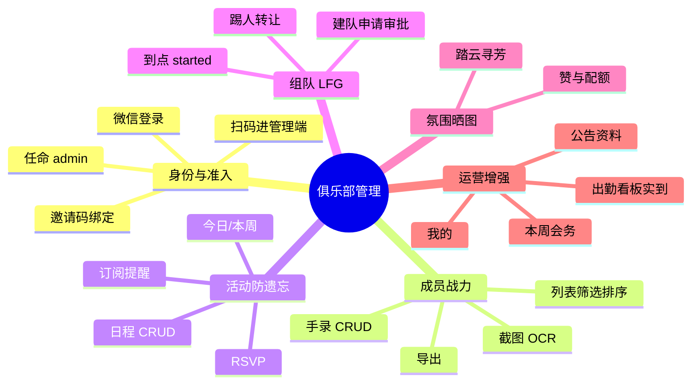
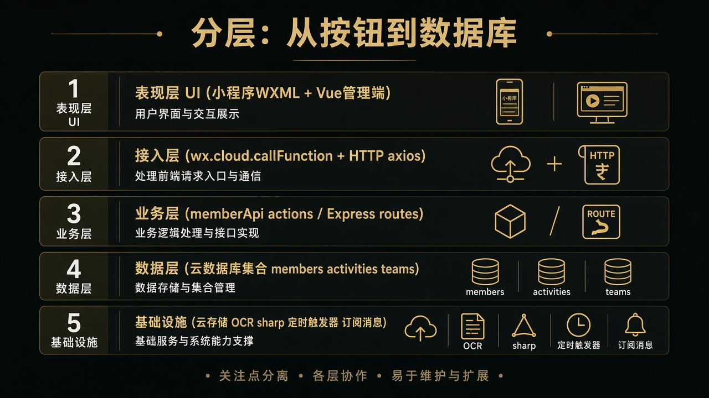
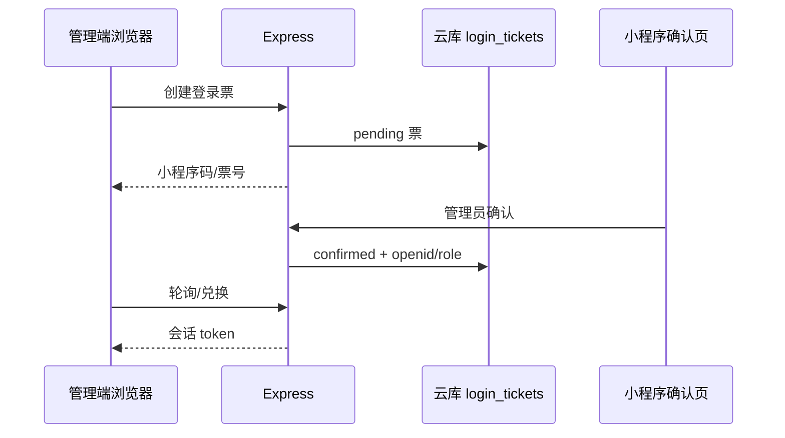
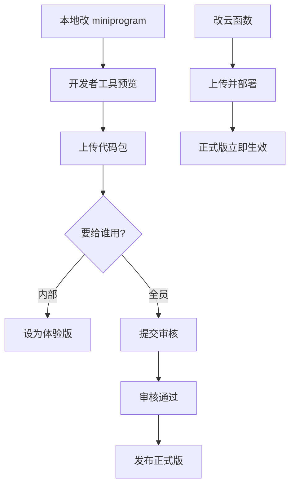

# 诡秘之主 · 俱乐部管理 —— 技术科普学习手册

> **推荐阅读**：**图文 HTML 版** → [`技术科普学习手册.html`](./技术科普学习手册.html)（浏览器直接打开，含侧栏导航、插图与流程图）。  
> **写给谁**：产品需求主要由你口述、技术选型与实现由 Agent 完成；本手册把「为什么这样造、每块叫什么、怎么连起来」讲清楚，方便你系统复习。  
> **怎么读**：先看第 1～3 章建立大局观，再按兴趣跳读名词扫盲 / 分功能技术点 / 运维发布。  
> **配套图**：`docs/assets/`（架构、分层、双通道、发布流水线）；HTML 内嵌 Mermaid。  
> **权威产品文档仍以** `功能说明书.md`、`数据模型草案.md`、`进度与交接.md` **为准**；本手册偏「学原理」，不替代交接与验收清单。

---

## 目录

1. [项目总体需求概述](#1-项目总体需求概述)
2. [顶层设计思路](#2-顶层设计思路)
3. [功能划分与分层](#3-功能划分与分层)
4. [技术选型与理由](#4-技术选型与理由)
5. [名词扫盲](#5-名词扫盲)
6. [分功能关键技术点](#6-分功能关键技术点)
7. [运维 · 部署 · 发布](#7-运维--部署--发布)
8. [工程协作与文档驱动](#8-工程协作与文档驱动)
9. [建议学习路径](#9-建议学习路径)

---

## 1. 项目总体需求概述

### 1.1 一句话

为单俱乐部「诡秘之主」MMO 社群，做一套**成员战力可查、活动不易忘、组队可招、晒图有氛围、出勤可盘**的运营工具——**不做**陪玩分账、积分商城、语音、游戏官方 API 自动同步、多俱乐部 SaaS。

### 1.2 两类核心痛点（产品原点）

| 痛点 | 产品手段 |
|------|----------|
| 成员战力不清 | PC 手录 / 截图 OCR 维护非凡评分、风尚度、途径等；小程序只读查看 |
| 活动容易忘记 | 今日/本周日程、RSVP（参加/待定/请假）、可配置的微信订阅提醒；再与组队打通 |

后续叠了：踏云寻芳（晒图）、出勤看板与实到、「我的」、本周会务摘要等运营增强。

### 1.3 用户是谁

| 角色 | 主要入口 | 能做什么（摘要） |
|------|----------|------------------|
| 超管 `super_admin` | PC 管理端 | 全部管理能力 + 任命管理员 + 危险重置 + 应急口令 |
| 管理员 `admin` | PC 管理端 | 成员/活动/公告/邀请码/提醒/出勤/踏云管理；不可任命超管 |
| 成员 `member` | 微信小程序 | 看名单与活动、RSVP、提醒、组队、晒图、「我的」 |
| 访客 `guest` | 小程序入会页 | 只能用邀请码 + 角色名申请绑定，通过前看不到名单细节 |

### 1.4 规模与边界

- 体量：约 **100～200** 人单俱乐部。
- 数据源头：**管理端录入**（手录 + OCR），邀请码**不新建角色**，只把微信绑到已有角色名。
- 已正式上线（2026-10-30）；暂缓项如管理端队伍总览（P2-e）、订阅消息会务触达（P4 A-c）不在本手册「已交付」主路径。

---

## 2. 顶层设计思路

### 2.1 三端分离（不要揉成一个前端）


| 目录 | 端 | 职责 |
|------|----|------|
| `miniprogram/` | 微信小程序 | 成员日常：列表、日程、RSVP、组队、晒图、会务 |
| `admin/` | PC Web | 管理员运营：CRUD、OCR、看板、导出、扫码登录 |
| `cloud/` | 后端 | 云函数、本地/云主机 Express、定时任务、库规则约定 |

**为什么拆开？**

- 小程序只能跑在微信运行时（WXML/WXSS），和浏览器 Vue 技术栈不同。
- 管理端需要大表、拖拽粘贴 OCR、导出 Excel，适合桌面浏览器。
- 后端权限与密钥不能放在前端；写操作统一走服务端校验角色。

### 2.2 「双通道后端」——理解本项目最关键的设计

同一份**云数据库**，被两条路读写：

```mermaid
flowchart LR
  subgraph MP[成员端]
    A[小程序] -->|wx.cloud.callFunction| B[云函数 memberApi 等]
  end
  subgraph AD[管理端]
    C[Vue admin] -->|HTTP /api| D[Express dev-server]
    D -->|@cloudbase/node-sdk| E[(云数据库/云存储)]
  end
  B --> E
```

| 通道 | 谁在用 | 技术 | 为何这样 |
|------|--------|------|----------|
| **云函数** | 小程序 | `wx-server-sdk`，部署在微信云开发 | 小程序原生友好；免自备公网域名即可调后端；定时触发器方便发提醒 |
| **Express 本机/云主机** | 管理端 | Node + `@cloudbase/node-sdk` | PC Web 用 HTTP 最自然；OCR/上传大图更适合在自有 Node 进程里跑（Python RapidOCR、sharp 等）；开发时本机 `3789` 即可联调 |

记忆口诀：**成员走云函数；管理员走 Express；数据都进同一云库。**

### 2.3 安全与权限思路

1. **角色在服务端校验**：前端按钮只是体验；真正增删改在云函数 / Express 里查 `users.role`。
2. **密钥不进仓库**：`dev-server/.env`、腾讯云 Secret、应急口令均 gitignore。
3. **绑定先于可见**：未通过邀请码关联的访客，看不到成员名单与活动细节。
4. **管理端双登录**：日常微信扫码（openid → admin）；另留超管应急账号防换绑翻车。

### 2.4 产品分期思路（为何不一次做完）

按 **P0 → P1 → 可用化 → P2 组队 → 上线 → P3 出勤 → P4 会务** 递进：先有「名单可录可看」，再有「活动不忘」，再有「组队」，再运营增强。P0 内部还规定：**先 cloud/API → 再 admin 手录（含主题 tokens）→ OCR → 最后小程序**——让你尽早在浏览器看到效果，而不是先铺一堆手机页却无数据。

### 2.5 主题与视觉铁律

业务页**禁止写死色值**；`admin/src/styles/tokens.css` 与 `miniprogram/styles/tokens.wxss` 抽离 Design Tokens。视觉对齐游戏 UI：暗色底 + 橄榄褐强调 `#bda377`，六条途径各有语义色。换肤只改 tokens，不改业务组件。

---

## 3. 功能划分与分层

### 3.1 按产品模块（你日常说的「功能」）



### 3.2 按软件分层（工程师视角）



| 层 | 本项目落点 | 你要记住的一句话 |
|----|------------|------------------|
| **表现层** | 小程序 pages + Vue views | 只负责展示与收集输入 |
| **接入层** | `callFunction` / `axios` → `/api` | 统一封装请求与错误 |
| **业务层** | `memberApi` 的 `action`；Express 路由 | 权限、状态机、业务规则 |
| **数据层** | 云库集合 `members`/`activities`/… | 字段以 `数据模型草案.md` 为准 |
| **基础设施** | 云存储、定时触发器、OCR、订阅消息 | 横切能力，被业务调用 |

### 3.3 仓库目录 ↔ 职责速查

```
俱乐部管理/
├── docs/                 # 产品与方案「权威真相」
├── miniprogram/          # 成员端 UI + 调 memberApi
├── admin/                # 管理端 UI + 调本机/云主机 API
└── cloud/
    ├── functions/        # 部署到微信云开发的云函数
    │   ├── memberApi/    # 成员端几乎所有业务 action
    │   ├── adminApi/     # 早期管理写/扫码相关（现管理端主路径多在 Express）
    │   ├── reminderDispatch/  # 定时发订阅消息
    │   └── teamLifecycle/     # 定时：队伍到点 → started
    └── dev-server/       # Express：管理端 API + 可选 SERVE_ADMIN 托管静态页
```

### 3.4 小程序信息架构（Tab）

底部三 Tab：**首页 / 活动 / 成员**。「我的」是内页，不是第四 Tab。非 Tab 页右下角小房子回首页。

管理端侧栏大致：成员、邀请码、活动日程、出勤看板、提醒、俱乐部资料、公告、踏云寻芳。

---

## 4. 技术选型与理由

### 4.1 总表

| 领域 | 选型 | 主要理由 |
|------|------|----------|
| 成员端 | **微信小程序原生**（WXML/WXSS/JS） | 目标用户就在微信；订阅消息、登录、码能力原生；俱乐部工具无需独立 App |
| 管理端 | **Vue 3 + Vite + Element Plus** | 后台表格/表单生态成熟；Vite 开发体验快；Element Plus 暗色主题可定制 |
| 后端运行时 | **微信云开发 CloudBase** + **自建 Express** | 小程序免运维入门快；管理端 OCR/公网托管需要可控的 Node 进程 |
| 数据库 | **云开发文档型数据库**（类 Mongo） | 与云函数同环境；集合模型灵活，适合迭代字段 |
| 文件 | **云存储** | 晒图、俱乐部图标、OCR 原图；fileID + 临时 URL |
| HTTP 客户端（管理端） | **axios** | 统一拦截器、错误处理 |
| 路由（管理端） | **vue-router** | SPA 多页 + 登录守卫 |
| 本地/生产管理 API | **Express + cors + multer** | 路由清晰；multer 处理上传 |
| 接云库（Node） | **@cloudbase/node-sdk** | 服务端用密钥访问同一环境 |
| 云函数 SDK | **wx-server-sdk** | 官方小程序云函数标准库 |
| 图像处理 | **sharp** | 压缩、缩放踏云图与 OCR 预处理 |
| OCR | **腾讯云 OCR（可选）→ RapidOCR（Python）→ tesseract.js** | 免费本地优先；云 OCR 备选；总有兜底 |
| 进程守护（云主机） | **pm2 / NSSM**（文档推荐） | Windows 云主机常驻 Node |
| 反代 HTTPS | **Nginx / IIS / Caddy**（按主机） | 证书与 443；Node 只听本机 |

### 4.2 为什么「小程序不选 uni-app / Taro」？

单端微信、团队/Agent 用原生成本最低；少一层编译与兼容坑。若将来要做 App，再考虑跨端——当前明确不做。

### 4.3 为什么管理端不直接嵌在小程序里？

管理场景是大屏、多列表格、剪贴板粘贴截图、CSV 导出；小程序交互与审核类目都不适合当「完整运营后台」。扫码登录把「微信身份」接到 PC，是折中。

### 4.4 为什么提醒用「订阅消息」而不是短信？

零短信成本、在微信内触达、与小程序一体；代价是用户须主动点「提醒我」授权（一次一授权额度），且模板要在公众平台申请。

---

## 5. 名词扫盲

按「从外到内」排列；读完应能向别人口述本项目骨架。

### 5.1 微信与小程序

| 名词 | 白话 |
|------|------|
| **AppID** | 小程序身份证，如 `wx0a3fc7a2aee9f66f`。所有接口都认它。 |
| **openid** | 某用户在**这个小程序**下的唯一编号。绑定成员、发订阅消息都靠它。 |
| **unionid** | 同一开放平台下跨应用统一 ID；本项目主路径用 openid 即可。 |
| **体验版 / 正式版** | 体验版给内部试；正式版公开。订阅消息「下发环境」必须和用户打开的版本一致（`trial` vs `formal`）。 |
| **备案** | 国内小程序上架前的合规流程；本项目已通过。 |
| **提审 / 发布** | 上传代码包 → 微信审核 → 通过后「发布」用户才看到新包。**云函数单独部署，不走小程序审核。** |
| **WXML / WXSS** | 小程序的「HTML / CSS」；逻辑用 JS。 |
| **TabBar** | 底部固定导航；本项目首页/活动/成员。 |

### 5.2 云开发（CloudBase）全家桶

| 名词 | 白话 |
|------|------|
| **微信云开发 / CloudBase** | 腾讯给小程序的一站式 BaaS：云函数 + 云数据库 + 云存储 + 静态托管等，免自建机房。 |
| **环境 ID** | 如 `cloud1-d6gjqx2kd2f3765f4`，相当于「哪一套云资源」。 |
| **云函数** | 把一段 Node 代码上传到云端；小程序 `callFunction` 触发；按调用计费/配额。类似「按需执行的后端接口」。 |
| **云数据库** | 文档库（JSON 文档集合），不是传统 MySQL 表（概念上接近 MongoDB）。 |
| **集合 collection** | 一类文档的容器，如 `members`、`activities`。 |
| **云存储** | 存图片等文件；返回 `cloud://` fileID；可用临时 HTTPS 链接给前端展示。 |
| **定时触发器** | 按 cron 自动调某个云函数，如每分钟跑 `reminderDispatch`、`teamLifecycle`。 |
| **安全规则** | 控制客户端能否直读写库/存储；敏感写仍应放云函数，规则作纵深防御。 |

**云开发 ≠ 云主机**：云开发是微信侧托管服务；你另有一台 Windows 云主机跑 Express + 管理端静态页——两者通过**同一套云库密钥**连数据。

### 5.3 Web 前端

| 名词 | 白话 |
|------|------|
| **SPA** | 单页应用：一次加载后前端路由切页，不整页刷新。admin 就是 SPA。 |
| **Vue 3** | 组件化 UI 框架；用响应式数据驱动视图。 |
| **Vite** | 开发服务器与打包工具；`npm run dev` / `build`。 |
| **Element Plus** | 基于 Vue 的后台组件库（表格、对话框、表单）。 |
| **Design Tokens** | 把颜色、圆角、间距提成变量；换肤改一处。 |
| **axios** | 浏览器里发 HTTP 请求的库。 |
| **路由守卫** | 进页前检查是否登录；未登录踢去 `/login`。 |

### 5.4 Node 与 API

| 名词 | 白话 |
|------|------|
| **Node.js** | 用 JS 写服务端的运行时。 |
| **Express** | 轻量 Web 框架：定义 `GET/POST /api/...`。 |
| **REST / HTTP API** | 用 URL + 方法表达资源操作；管理端主要走这套。 |
| **CORS** | 浏览器跨域策略；本机 Vite `5173` 调 `3789` 需要代理或 CORS。 |
| **multer** | Express 中间件，解析 `multipart` 上传文件（OCR 截图）。 |
| **环境变量 `.env`** | 本机密钥配置；**绝不提交 Git**。 |
| **SDK** | 官方封装好的调用库（如 `@cloudbase/node-sdk`）。 |

### 5.5 业务域名词

| 名词 | 白话 |
|------|------|
| **RSVP** | 出席意向：参加 / 待定 / 请假；**不是**实到点名。 |
| **实到** | 管理端点名「人来了没」；与 RSVP 分离。 |
| **周期活动 / 一次性活动** | 仅周几等为周期模板，换场清 RSVP+队伍但状态保持已发布；锚定具体日期的结束后自动 `ended`。 |
| **跨日周常容器** | 如周一 00:00～周日 23:59：默认只出现在「本周」；有「今天开打的队伍」才抬进今日/会务。 |
| **LFG** | Looking For Group，组队招募。 |
| **订阅消息** | 用户授权后，服务端可向其发的微信模板消息（有次数限制）。 |
| **OCR** | 光学字符识别：从图里认出字，再按版面解析成成员行。 |
| **fileID / 临时 URL** | 云存储身份 vs 有过期时间的可访问链接（试用期权限紧时靠临时 URL 互看图）。 |

### 5.6 Git 与协作（你已在用）

| 名词 | 白话 |
|------|------|
| **commit / push** | 本地快照 / 推到 GitHub。本仓库约定：**你没明确说就不要 commit**。 |
| **HEAD** | 当前所在提交；进度文件会记短 hash。 |
| **gitignore** | 忽略 `.env`、`node_modules`、`admin/dist` 等。 |

---

## 6. 分功能关键技术点

下列「第三方包」以仓库 `package.json` 与文档为准；云函数侧依赖极简（基本是 `wx-server-sdk`）。

### 6.1 成员档案与列表

| 项 | 说明 |
|----|------|
| **能力** | CRUD、角色名唯一、途径筛选、移出解绑、导出 |
| **数据** | 集合 `members`；`characterName` 唯一；`boundOpenid` 关联微信 |
| **管理端包** | Vue 表格 + axios；导出多为前端生成 CSV/Excel 风格文本 |
| **成员端** | `memberApi` → `membersDb.js`；列表排序筛选在云函数或前端完成 |

**关键点**：角色名是**业务主键**（无游戏数字 ID）；已退出同名再导入会**恢复在职**。

### 6.2 截图 OCR 导入

| 项 | 说明 |
|----|------|
| **流程** | 上传多图 → 识别 → **人工确认预览** → 按角色名 commit |
| **引擎优先级** | 腾讯云 OCR（可选密钥）→ **RapidOCR**（本机 Python `rapidocr_onnxruntime`）→ **tesseract.js** |
| **包** | `multer` 上传、`sharp` 预处理、`tesseract.js`；RapidOCR 在 Python 子进程 |
| **版面** | `parseRapidLayout.js` 等按「俱乐部成员列表」坐标/行列启发式解析 |

**为什么必须确认预览？** OCR 会错字；静默覆盖战力不可接受。

### 6.3 邀请码入会（P0-e）

| 项 | 说明 |
|----|------|
| **能力** | 管理端生成码；访客提交「码 + 角色名」；审核通过写入绑定 |
| **要点** | **不创建**新 `members`；角色名必须已在名单且未被他人绑定 |
| **集合** | `invite_codes`、`join_applications`、`users` |

### 6.4 管理端扫码登录（P0-c）



| 项 | 说明 |
|----|------|
| **包/能力** | 微信「小程序码」接口；票有过期；正式环境 `CLOUD_QR_ENV_VERSION=release` |
| **应急** | `EMERGENCY_*` 账号密码哈希校验（防微信号换绑） |

### 6.5 活动日程与 RSVP

| 项 | 说明 |
|----|------|
| **集合** | `activities`、`rsvps`（及周期快照相关字段/集合，见数据模型） |
| **难点** | 「开始/结束」可拆成年月日/时间/周几；周期 vs 一次性状态机；跨日周常可见口径（`scheduleMatch.js`） |
| **RSVP** | `going` / `maybe` / `decline`；本场结束后不可再表态；周期换场先快照再清 |

**学习价值**：这是典型的**领域状态机**——比 CRUD 更考验产品规则写成代码。

### 6.6 订阅消息提醒（P1-d）

| 项 | 说明 |
|----|------|
| **谁发** | 云函数 `reminderDispatch` + **定时触发器** |
| **谁订** | 小程序里用户点「提醒我」→ 写入订阅记录 |
| **配置** | `club_profile.reminderOffsetsMinutes`、模板 ID、`subscribeMiniprogramState` |
| **注意** | 正式用户必须 `formal`；体验验收用 `trial`；周期活动有「场次日去重 / 续订」逻辑 |

### 6.7 组队 LFG（P2）

| 项 | 说明 |
|----|------|
| **集合** | `teams` 及申请/成员关系字段 |
| **状态** | 招募中 → 满员/进行中 → 结束等（见 `P2组队.md`） |
| **定时** | `teamLifecycle`：按 `teams.startAt` 到点改 `started` |
| **产品** | 默认人数上限 6；途径折算 T/N/D 缺口文案 |

### 6.8 踏云寻芳（晒图）

| 项 | 说明 |
|----|------|
| **上传** | 小程序选图 → 客户端/`galleryUpload` 压缩 → 云存储路径 `gallery/{memberId}/…` |
| **规格** | 主图最长边约 1920、缩略 480、JPEG；单次合计过大拒传；软配额约 2GiB |
| **包** | 管理端/服务端侧 `sharp`；小程序端压缩逻辑自研工具函数 |
| **互看** | 试用期存储权限紧 → `getTempFileURL` 临时链接兜底 |

### 6.9 公告与俱乐部资料

| 项 | 说明 |
|----|------|
| **集合** | `announcements`、`club_profile`（单文档） |
| **展示** | 首页轮播；置顶优先；日期格式化注意真机 `Intl` 兼容（曾踩坑） |

### 6.10 出勤看板与实到（P3）

| 项 | 说明 |
|----|------|
| **入口** | 仅管理端；API 在 **Express**（`cloudBoard.js` / `cloudAttendance.js`），改完须重启 dev-server |
| **能力** | 今日/本周汇总、点名、未报名补录、导出点名表 |
| **「我的」** | 小程序 `deskDb.js` / `myDesk`；聚合个人 RSVP 与队伍 |

### 6.11 本周会务（P4）

| 项 | 说明 |
|----|------|
| **云函数** | `weekHub`（`weekHubDb.js`）聚合首页摘要 |
| **内容** | 我的 RSVP、队伍缺口、本日/本周活动紧迫展示等 |
| **未做** | A-c 订阅消息主动触达（更后） |

### 6.12 主题与途径色

| 项 | 说明 |
|----|------|
| **tokens** | CSS 变量 / WXSS 变量 |
| **途径色** | 观众/战士/歌颂/学徒/占卜/窥秘；列表色签与行渐变；`pathway` 工具前后端各有一份语义 |

---

## 7. 运维 · 部署 · 发布

### 7.1 你实际在跑的三套「环境感」

| 场景 | 小程序 | 管理端 | 数据 |
|------|--------|--------|------|
| 本机开发 | 开发者工具 / 开发版 | Vite `5173` + API `3789` | 云库（`DATA_BACKEND=cloud`） |
| 体验验收 | 体验版 | 可仍用本机或云主机 | 同一云库 |
| 生产 | **正式版** | Windows 云主机 `SERVE_ADMIN=1` 托管 `admin/dist` | 同一云库 |

### 7.2 改代码后「要部署什么」速查

| 你改了什么 | 要做什么 |
|------------|----------|
| `miniprogram/` 页面逻辑/样式 | 开发者工具上传 →（正式）提审 → 发布 |
| `cloud/functions/memberApi` 等 | 开发者工具：**上传并部署云函数**（正式用户**立刻**吃到，不等小程序审核） |
| `reminderDispatch` / `teamLifecycle` | 部署云函数 + 确认**定时触发器开启** |
| `admin/` 前端 | 本机 `npm run build` → 把 `admin/dist` 拷到云主机 → 重启 Node |
| `cloud/dev-server` 路由 | 云主机上更新代码并**重启** Express；本机开发也要重启（无热重载） |
| 仅云库数据 | 控制台或管理端操作；一般不用发版 |

**常见误区**：以为改了云函数也要等小程序审核——**不用**。反过来：只部署云函数、小程序包仍旧，也可能出现「新旧协议」短暂不一致，重要接口变更宜两端对齐。

### 7.3 管理端公网（方案甲）

```text
浏览器 ──HTTPS──► Nginx/IIS(443) ──► Node 127.0.0.1:3789
                                      ├─ /api/*  业务
                                      └─ 其它    admin/dist 静态资源
```

要点：

1. 服务器 `.env` 含 `CLOUDBASE_*`、`SERVE_ADMIN=1`、`HOST` 等（**勿把密钥贴到聊天**）。
2. 用 pm2/NSSM 保活，不要靠远程桌面窗口挂着 node。
3. 正式建议域名 + HTTPS；临时 `IP:3789` 仅冒烟。

细节见 `docs/管理端公网托管.md`。

### 7.4 小程序发布流水线（心智模型）



### 7.5 监控与排障（实用级）

- 云开发控制台：云函数日志、数据库、存储配额。
- 管理端 API：看 Express 控制台；`/api/health` 可看后端是否活着、成员数据源。
- OCR 失败：查引擎是否落到 Tesseract、网络 ECONNRESET、确认表人工改。
- 订阅消息没收到：查模板 ID、用户是否授权、下发环境是否 `formal`、触发器是否跑、去重逻辑是否吞掉。
- 踏云看不到别人图：临时 URL / 存储权限。

### 7.6 密钥与安全清单（运维必记）

- [ ] `.env` 永不入库  
- [ ] 应急口令定期更换并足够长  
- [ ] 云主机安全组最小开放（80/443；慎长期裸奔 3789）  
- [ ] 超管 openid / `ADMIN_OPENIDS` 白名单谨慎  
- [ ] 正式公开前清联调脏数据（本项目已做过一轮运营数据清空）  

---

## 8. 工程协作与文档驱动

本项目对你学习「和 AI 一起做产品」特别有示范意义：

| 机制 | 作用 |
|------|------|
| `AGENTS.md` + `.cursor/rules/` | 跨会话/跨机器的铁律入口 |
| `功能说明书.md` | 产品真相；冲突时以文档为准 |
| `进度与交接.md` | 当前做到哪、下一步、阻塞 |
| `数据模型草案.md` | 集合字段契约 |
| 「文档与代码必须同步」 | 防止 Agent 只改代码导致下个会话失忆 |

**你可以学到的工程观**：需求先落文档 → 按阶段切片验收 → 密钥与产物（`dist`）分离 → 用进度文件代替聊天记忆。

---

## 9. 建议学习路径

按「投入时间」递进，不必一次读完代码。

### 第 1 天：建立地图（2～3 小时）

1. 重读本手册第 1～5 章。  
2. 对照打开三个目录：`miniprogram/pages`、`admin/src/views`、`cloud/functions/memberApi`。  
3. 本地启动：`dev-server` + `admin`，点一遍成员/活动页面，打开浏览器 Network 看 `/api`。

### 第 2～3 天：跟一条完整链路

选一条：

- **邀请码绑定**：小程序 `join` → `memberApi` invites → 管理端审核 → `members.boundOpenid`。  
- **RSVP + 提醒**：活动详情表态 → 订阅记录 → `reminderDispatch` 日志。  
- **OCR**：粘贴截图 → 预览 → commit → 云库成员变化。

每条链路自己画一张「谁调谁」草图（可照抄本手册 Mermaid）。

### 第 4 天：读状态机

精读 `功能说明书` 活动/RSVP/队伍章节 + `scheduleMatch.js` 注释级阅读——这是业务含金量最高的部分。

### 进阶

- 自己改一处 tokens 颜色，看两端是否一起变。  
- 在云开发控制台看集合文档长什么样。  
- 读 `docs/管理端公网托管.md`，对照云主机目录想一遍发布动作。

---

## 附录 A · 核心依赖速查

**admin**

- `vue` / `vue-router` / `element-plus` / `axios` / `vite`

**cloud/dev-server**

- `express` / `cors` / `multer` / `sharp` / `tesseract.js` / `uuid` / `@cloudbase/node-sdk`  
- 可选：本机 Python `rapidocr_onnxruntime`；腾讯云 OCR SDK

**云函数**

- `wx-server-sdk`（memberApi / adminApi / reminderDispatch / teamLifecycle）

**小程序**

- 无 npm 业务巨石；原生 + `wx.cloud.*`

## 附录 B · 关键文档索引

| 想深入… | 去读 |
|---------|------|
| 产品规则全文 | `功能说明书.md` |
| 集合字段 | `数据模型草案.md` |
| 分期与验收 | `开发阶段规划.md` |
| 当前状态 | `进度与交接.md` |
| 上线勾选 | `上线待办.md` |
| 云环境开通 | `微信云开发开通指南.md` |
| 管理端公网 | `管理端公网托管.md` |
| 组队 / 踏云 / 出勤 / 会务 | `P2组队.md`、`踏云寻芳实现.md`、`P3出勤与个人中心.md`、`P4本周会务.md` |

## 附录 C · 一张纸背下来

```text
成员用小程序 → 云函数 memberApi → 云库
管理用 Vue   → Express(/api)   → 同一云库（+ OCR/sharp）
提醒/到点    → 定时云函数
主题         → tokens，不写死色
权限         → 服务端认 role；邀请码只绑定不建人
发布         → 小程序要审核；云函数部署即生效；admin 要 build+拷主机
```

---

*手册生成说明：基于仓库文档与目录扫描整理；若与线上行为冲突，以 `功能说明书.md` / `进度与交接.md` 及已部署代码为准。*
